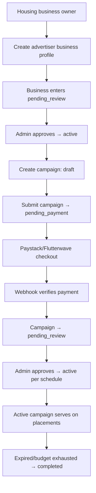

# ADVERTISING

This document records the advertising marketplace system.

## Architecture overview



## No fourth marketplace role (spec Section 1)

The advertising system is **completely separate** from the three marketplace roles (landlord, agent, company). Advertisers have their own `advertising_businesses` table referencing `auth.users` directly — NOT `profiles.role`. The `profiles.role` CHECK constraint remains `('landlord', 'agent', 'company')` only.

A user can have both a marketplace account AND an advertising business, but the advertising identity is a separate entity.

## Business profile (spec Section 2)

`advertising_businesses` table (migration 0012):
- `owner_user_id` — references `auth.users` (NOT profiles)
- `business_name`, `category_id`, `contact_email`, `contact_phone`, `website`, `description`
- `logo_url`, `address`, `state`, `city`
- `status`: active | pending_review | suspended | rejected | archived

Businesses are NOT verified automatically because they pay. Advertising status ≠ verification status (spec Section 32).

## Categories (spec Section 3)

`advertiser_categories` table — 15 categories seeded (migration 0012, seed 004):
Carpentry, Interior Design, Furniture, Plumbing, Electrical, Architecture, Quantity Surveying, Building Materials, Painting, Landscaping, Cleaning, Moving, Security, Generator/Solar, Home Appliances, Other.

Extensible — admin can add categories without code changes.

## Campaign model (spec Section 4)

`advertising_campaigns` table (migration 0012):
- `business_id`, `name`, `creative_id`, `placement_id`
- `budget_naira` (kobo, CHECK >= 500000), `spent_naira` (CHECK >= 0, <= budget)
- `target_categories[]`, `target_states[]`, `target_cities[]`
- `starts_at`, `ends_at`, `reviewed_at`, `reviewer_id`
- `impressions`, `clicks`, `payment_id`
- `status`: draft | pending_payment | pending_review | active | paused | completed | rejected | cancelled

### State transitions (`CAMPAIGN_TRANSITIONS` in config.ts):
```
draft → pending_payment → pending_review → active → completed
                ↓               ↓             ↓
            cancelled       rejected      paused → active
                            cancelled     cancelled
```

## Minimum budget (spec Section 5)

**₦5,000** enforced at 3 levels:
1. **DB**: `CHECK (budget_naira >= 500000)` (kobo)
2. **Config**: `MIN_CAMPAIGN_BUDGET_NAIRA = 5000` in config.ts
3. **Server action**: `createCampaignAction()` validates `input.budgetNaira >= MIN_CAMPAIGN_BUDGET_NAIRA`

Never trusts client-supplied amount.

## Payment integration (spec Sections 12, 13)

Reuses the existing Paystack/Flutterwave abstraction from Prompt 13:
- `submitCampaignAction()` → calls `initiatePayment()` with `paymentType: "advertising"`
- Server-side price authority: uses `camp.budget_naira` from DB (not client)
- Webhook verifies payment → campaign moves to `pending_review`
- Campaign does NOT auto-activate on payment — requires admin review (spec Section 14)

## Campaign review (spec Section 14)

After payment verification, campaigns enter `pending_review` — NOT `active`.
Admin must approve before activation. This prevents paid ads from bypassing moderation.

Service-layer foundations (`eligibility.ts`):
- `canServeCampaign()` — checks status, advertiser status, dates, budget
- `isValidTransition()` — validates state transitions

## Eligibility (spec Section 16)

`canServeCampaign(campaignId)`:
1. Campaign status must be `active`
2. Advertiser status must be `approved`
3. Campaign dates must be valid (started + not expired)
4. Budget must not be exhausted

Rejected/cancelled/expired campaigns never serve. Suspended advertisers' campaigns don't serve.

## Ad labeling (spec Section 15)

- Business profile page (`/businesses/[id]`): shows `Sponsored` badge
- Advertise page (`/advertise`): clearly states "separate from marketplace roles"
- All sponsored content uses the `SponsoredBadge` component

## RLS (spec Section 29)

| Table | User access | Server access |
|---|---|---|
| `advertising_businesses` | Read approved publicly + own all | Full (service-role) |
| `advertising_campaigns` | Read active publicly + own all | Full (service-role) |
| `advertising_creatives` | Read active campaign creatives + own all | Full |
| `advertiser_categories` | Read (public) | — |
| `advertising_placements` | Read (public) | — |

## Audit events (spec Section 31)

- `business_created`
- `campaign_created`
- `campaign_submitted`
- `campaign_paused` / `campaign_active` / `campaign_cancelled`

No secrets in audit metadata.

## Advertising vs Featured (spec Section 26)

| System | Promotes | Tables |
|---|---|---|
| Featured Listings | A **property** | `featured_listings`, `featured_listing_credits` |
| Advertising | A **business/service** | `advertising_campaigns`, `advertising_businesses` |

Separate domain models, separate permissions. Shared: payment infrastructure, analytics utilities, moderation infrastructure.

## Routes

| Route | Purpose |
|---|---|
| `/advertise` | Public landing page — how it works, categories, CTA |
| `/dashboard/advertising` | Advertiser dashboard — businesses + campaigns + create dialogs |
| `/businesses/[id]` | Public business profile — name, logo, category, description, contact, Sponsored badge |

## Future extension points

- Admin campaign review dashboard (approve/reject/pause)
- Creative upload (image banner) with file validation
- Click tracking with open-redirect prevention
- Impression tracking via server-side recording
- Fair rotation mechanism
- Campaign analytics dashboard
- Category-specific and location-specific ad serving
