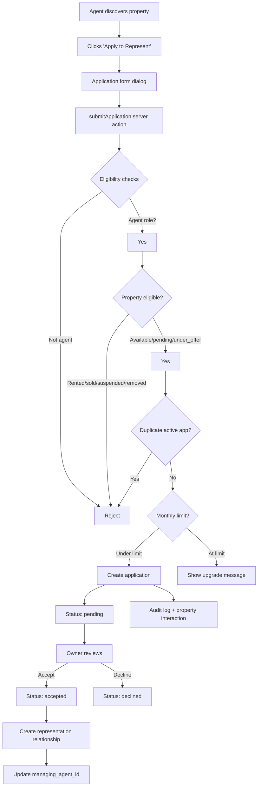

# APPLICATIONS

This document records the agent application + property representation system.

## Architecture overview



## Application statuses (spec Section 2)

| Status | Meaning | Terminal? |
|---|---|---|
| `pending` | Agent has submitted; waiting for owner review | No |
| `accepted` | Owner accepted; representation established | No (can withdraw/end) |
| `declined` | Owner declined | Yes |
| `withdrawn` | Agent withdrew | Yes |
| `expired` | Auto-expired (30-day default) | Yes |
| `completed` | Representation lifecycle ended | Yes |

Status transitions defined in `src/types/applications.ts` (`APPLICATION_TRANSITIONS`):
- `pending → accepted | declined | withdrawn | expired`
- `accepted → completed | withdrawn`
- All other states are terminal

## Who can apply (spec Section 4)

Only users with `role = 'agent'` can submit applications. Role is derived from the server-side profile via `getCurrentProfile()` — never from client-submitted values.

Landlords and companies CANNOT apply (they own/manage properties, not represent others').

## Monthly application limits (spec Section 7)

Enforced server-side in `submitApplication()` via `capabilitiesFor(role, tier).maxApplicationsPerMonth`:

| Plan | Monthly limit |
|---|---|
| Agent Free | 10 |
| Agent Pro | 25 |
| Agent Premium | 500 (fair-use ceiling) |

**What counts toward the limit**: only NEW submitted applications (status = pending/accepted/declined/withdrawn/expired/completed all count since they represent a submission event). Withdrawal + resubmission creates a new application row, which counts.

**What does NOT count**: viewing a property, editing an existing application (no edit endpoint — applications are immutable once submitted).

When at limit: the action returns `{ ok: false, limitReached: true, message: "..." }` with an upgrade CTA link. Existing applications are NOT affected.

## Duplicate application prevention (spec Section 11)

Database-level: `property_applications` has an EXCLUDE constraint:
```sql
EXCLUDE (property_id WITH =, agent_id WITH =)
WHERE (status IN ('pending', 'accepted'))
```

This prevents two active (pending OR accepted) applications for the same (property, agent) pair. The server action also checks this before insert for a better error message.

If the previous application was declined/withdrawn/expired, the agent CAN submit a new one (subject to monthly limits).

## Application form (spec Sections 8, 9)

The `ApplicationFormDialog` component (`src/components/applications/application-form-dialog.tsx`) opens when an eligible agent clicks "Apply to Represent" on the property detail page.

### Required fields
- `application_message` (min 10 chars, max 2000)

### Optional fields
- `proposed_commission_pct` (0–100%)
- `proposed_commission_flat` (Naira amount in kobo)
- `additional_info` (JSONB — free-form metadata)

### Pre-submission reminder
"Submitting an application does not guarantee acceptance or representation rights."

## Application dashboard (spec Sections 12, 15)

`/dashboard/applications` — role-aware:
- **Agents** see applications they submitted (with withdraw/end actions)
- **Landlords/Companies** see applications they received (with accept/decline actions)

The `ApplicationsDashboard` component (`src/components/applications/applications-dashboard.tsx`) handles both views. The role is determined from the server-side profile — never from the client.

### Agent view
- Property image, title, location, price
- Property owner name + role
- Application status badge
- Applied date + decided date
- Actions: Withdraw (pending), End representation (accepted)
- Monthly limit counter (e.g. "3 / 10 applications used this month")

### Owner view
- Property image, title, location, price
- Applicant agent name + verification badge + experience
- Application status badge
- Actions: Accept (pending), Decline (pending)
- Proposed commission percentage

## Application detail (spec Section 13)

`/dashboard/applications/[id]` — shows:
- Property summary (image, title, location, price, transaction type)
- Application details (date, message, proposed commission, decision reason)
- Agent profile (name, photo, verification badge, experience)
- Decision maker profile (name, role)
- Representation explanation if accepted
- Action buttons based on caller role + status

Authorization: the caller must be the agent who submitted OR the decision maker. Unrelated users see "Application not found".

## Representation relationship (spec Sections 18, 19, 34)

Migration `0020_property_agent_representations.sql` creates a dedicated table:

| Column | Type | Purpose |
|---|---|---|
| `property_id` | uuid | The property being represented |
| `agent_id` | uuid | The representing agent |
| `owner_id` | uuid | The owner/company that authorised |
| `source_application_id` | uuid | The application that created this |
| `status` | text | active / ended / suspended |
| `starts_at` | timestamptz | When representation began |
| `ends_at` | timestamptz | When it ended (nullable) |
| `end_reason` | text | Why it ended |

**UNIQUE constraint** on `(property_id, agent_id)` prevents duplicate representations for the same pair.

### Multiple agents per property (spec Section 19)

The system supports multiple agents representing a property — each accepted application creates a separate representation row. The `properties.managing_agent_id` column (from migration 0005) identifies the PRIMARY managing agent; the `property_agent_representations` table supports the full many-to-many model.

### Representation creation on accept

When `acceptApplication()` runs:
1. Update `property_applications.status` → 'accepted'
2. Insert into `property_agent_representations` (status='active')
3. Update `properties.managing_agent_id` if null (first agent becomes primary)
4. Insert `property_interactions` row (stage='offer_accepted')
5. Write `audit_logs` entry

## RLS (spec Section 35)

### property_applications (from migration 0007)
- Agents can SELECT their own (via `agent_id = profile.id`)
- Agents can INSERT (submit) — with the EXCLUDE constraint preventing duplicates
- Decision makers can UPDATE (accept/decline) — via `decision_maker_id = profile.id`

### property_agent_representations (from migration 0020)
- Public can SELECT active representations for visible properties (so the property page can show "Represented by Agent X")
- Agents can SELECT their own representations
- Property owners can SELECT/INSERT/UPDATE/DELETE representations for their properties

## Server-side authorization (spec Section 36)

All server actions derive identity from `getCurrentUser()` + `getCurrentProfile()`:
- `submitApplication`: verifies `profile.role === 'agent'` + active account + monthly limit + duplicate check
- `withdrawApplication`: verifies `app.agent_id === profile.id` (agent who submitted)
- `acceptApplication`: verifies `app.decision_maker_id === profile.id` (owner who received)
- `declineApplication`: verifies `app.decision_maker_id === profile.id`

Never trusts client-supplied `userId`, `agentId`, `ownerId`, `role`, or `status`.

## Audit events (spec Section 41)

| Event | Action |
|---|---|
| `application.submit` | Agent submits an application |
| `application.withdraw` | Agent withdraws |
| `application.accept` | Owner accepts |
| `application.decline` | Owner declines |

All events write to `audit_logs` with `target_type='property_application'` + metadata.

Additionally, `property_interactions` records the deal workflow:
- `inquiry` on application submit
- `offer_accepted` on application accept

## Application data privacy (spec Section 37)

Application messages, proposed commission, and additional info are **private**:
- Not included in public property API responses
- Not in SEO metadata
- Not in public JSON-LD
- Only visible to the agent + decision maker

The `getApplicationById()` fetcher verifies the caller is either the agent or the decision maker before returning data.

## Property status interaction (spec Section 28)

Applications are blocked for properties in these statuses:
- `rented`, `sold` — no longer available
- `unavailable` — paused by owner
- `suspended` — admin suspended
- `removed` — soft-deleted
- `draft` — not published

Applications allowed for: `available`, `application_pending`, `under_offer`.

## Extension points (spec Sections 31, 32)

### Notifications (P13)
The application events (`submit`, `accept`, `decline`, `withdraw`) are structured so a future notification system can react to them. The server actions write to `audit_logs` — a notification listener can watch this table.

### Messaging (P6)
The accepted representation relationship (`property_agent_representations`) can later authorize communication between the agent, owner, and company. The messaging system will check if a representation exists before allowing new conversations.

## Components

| Component | Location | Purpose |
|---|---|---|
| `ApplicationFormDialog` | `src/components/applications/application-form-dialog.tsx` | Modal dialog for submitting an application |
| `ApplicationStatusBadge` | `src/components/applications/application-status-badge.tsx` | Color-coded status pill |
| `ApplicationCard` | `src/components/applications/application-card.tsx` | Card used in dashboard list (role-aware actions) |
| `ApplicationsDashboard` | `src/components/applications/applications-dashboard.tsx` | Client component for the dashboard list |
| `ApplicationDetailClient` | `src/components/applications/application-detail-client.tsx` | Action buttons for the detail page |
| `PropertyActions` | `src/components/applications/property-actions.tsx` | "Apply to Represent" + Message + View properties buttons on property detail page |
