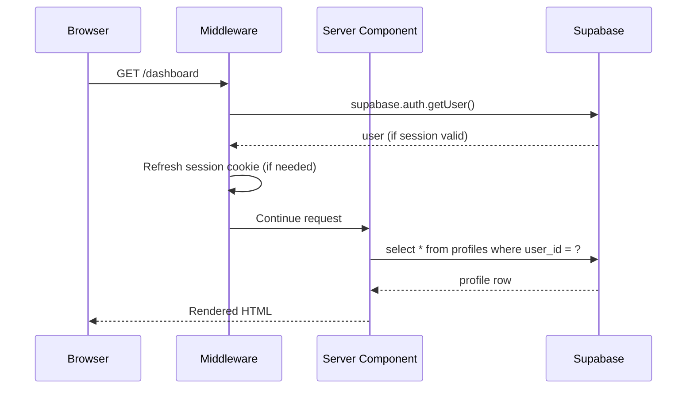

# AUTHENTICATION

This document records the authentication + onboarding architecture as implemented in this repository.

## Architecture overview

```mermaid
flowchart TD
    A[Visit /signup] --> B[Fill: name, email, phone, password, role, safety ack]
    B --> C[Client-side Zod validation]
    C --> D[signupAction server action]
    D --> E[Server-side Zod validation]
    E --> F[Rate-limit check by IP]
    F --> G[Supabase Auth.signUp]
    G --> H{Email confirmation enabled?}
    H -->|Yes| I[Redirect to /verify-email]
    H -->|No| J[ensureProfileRow]
    J --> K[Profile row inserted role + account_status=pending]
    K --> L[Redirect to /onboarding/{role}]
    I --> M[User clicks email link]
    M --> N[Supabase verifies token + creates session]
    N --> O[/auth/callback handler ensures profile row]
    O --> L
    L --> P[Role-specific multi-step form]
    P --> Q[submitXOnboarding server action]
    Q --> R[Server-side Zod validation per role]
    R --> S[Insert/upsert role-specific row]
    S --> T[Update profiles row with shared fields]
    T --> U[computeProfileCompleteness]
    U --> V{meetsMinimum?}
    V -->|No| W[Show checklist with what's missing]
    V -->|Yes| X[Set onboarding_completed=true, account_status=active]
    X --> Y[Redirect to /dashboard]
```

## Components

### Auth provider

**Supabase Auth** is the source of truth for authentication. The application does NOT implement its own password storage. All password handling, password-reset email sending, email verification, and session refresh happen via Supabase.

Three Supabase clients live in `src/lib/db/supabase/`:

| Client | Bound to | Use |
|---|---|---|
| Browser (`browser.ts`) | RLS — current authenticated user | Client Components, client-side calls |
| Server (`server.ts`) | RLS — current authenticated user | Server Components, Route Handlers, Server Actions |
| Admin (`admin.ts`) | service-role (bypasses RLS) | Webhook verifiers, automated jobs, admin actions only |

The admin client NEVER crosses the trust boundary to the browser — it's only imported by server modules and reads `SUPABASE_SERVICE_ROLE_KEY` (server-only env var).

### Sessions

Sessions are cookie-based via `@supabase/ssr`. The middleware (`src/middleware.ts`) refreshes the session cookie on every matched request so Server Components always see the latest auth state.



### Middleware route protection

`src/middleware.ts` enforces:

| Route prefix | Behavior |
|---|---|
| `/dashboard/*` | Requires authenticated session → else redirects to `/login?next=/dashboard/...` |
| `/admin/*` | Requires authenticated session → else redirects to `/login?next=/admin/...` (final admin role check happens in the route's server component via `requireAdmin()`) |
| `/onboarding/*` | Requires authenticated session → else redirects to `/login?next=/onboarding/...` |
| `/login`, `/signup` | Authenticated users redirect to `/dashboard` (server component redirects to `/onboarding/{role}` if onboarding incomplete) |

Deep-link preservation (spec Section 31): when an unauthenticated user visits `/properties/123` and clicks "login", they go to `/login?next=/properties/123` — after a successful login, they're returned to that path. `safeRedirect()` validates the next target is a relative path under our own origin (no `//protocol-relative`, no `/admin`, no `/api`).

### Account-status enforcement

Per spec Section 14, the application distinguishes:

| Status | Login allowed? | Marketplace access |
|---|---|---|
| `active` | ✅ | ✅ full |
| `pending` | ✅ | ⚠️ onboarding routes only |
| `suspended` | ✅ | ❌ redirected to `/account-suspended?reason=suspended` |
| `banned` | ❌ — login error message shown | n/a |
| `deactivated` | ❌ — treated as logged out | n/a |

Enforcement:
- **Login**: `loginAction` checks profile state after Supabase auth succeeds and routes accordingly.
- **Dashboard Server Component**: re-fetches profile + redirects to `/account-suspended` if suspended/banned/deactivated, or to `/onboarding/{role}` if onboarding incomplete.
- **Database layer**: profile `account_status` column has a CHECK constraint limiting values to the five valid states; the column default is `'pending'` (never `'active'`) so a brand-new account cannot bypass onboarding.

## Signup flow

### What the client submits

```ts
{
  fullName: string
  email: string
  phone: string  // Nigerian format; normalised to E.164 server-side
  password: string  // validated against PASSWORD_SCHEMA
  confirmPassword: string  // must match password
  role: "landlord" | "agent" | "company"  // validated against USER_ROLES enum
  acceptSafetyWarning: true  // literal true — acknowledgement of safety notice
}
```

### What the server persists

Only the **role** is persisted from the client. The DB defaults control everything else:

| Field | Set by | Value |
|---|---|---|
| `role` | client (via signupAction) | `landlord` / `agent` / `company` |
| `account_status` | DB DEFAULT | `'pending'` |
| `verification_state` | DB DEFAULT | `'unverified'` |
| `subscription_tier` | DB DEFAULT | `'free'` |
| `email_verified` | server | `false` (set true when Supabase confirms) |
| `phone_verified` | server | `false` (always — phone OTP is a later phase) |
| `onboarding_completed` | server | `false` (set true after onboarding submit) |
| `created_at` / `updated_at` | DB DEFAULT / trigger | `now()` |

A malicious user submitting `role=company, verification_status=blue, subscription=premium, account_status=active` cannot obtain those privileges — the server only persists `role` and ignores everything else; the DB CHECK constraints reject invalid values; the RLS UPDATE policy prevents users from changing `role` or `subscription_tier` once set.

### Verification of phone number

Phone is normalised to E.164 form (`+2348031234567`) before storage. The normalisation supports local (`0803 123 4567`), international (`+234 803 123 4567`), and stripped (`2348031234567`) forms. Invalid prefixes (e.g. `0700`, `0600`) are rejected.

Phone is NOT marked verified merely because the user entered it. Phone OTP verification is a later phase (after SMS provider credentials are configured).

## Email verification

Per spec Section 7. When Supabase email confirmation is enabled (default in production), signup returns a session-less response and the user is redirected to `/verify-email?email=...`. That page:

- Shows "Check your email" with the masked email
- Offers a "Resend verification email" button (rate-limited)
- Does NOT reveal whether an account with the entered email exists (the resend action returns the same success message regardless of account state)
- Provides a "Sign in" link for already-verified users
- Provides a "Start over" link for users who entered the wrong email

The actual verification happens when the user clicks the email link — Supabase verifies the token and creates the session. The `/auth/callback` handler (future — not needed in this foundation since Supabase handles the redirect itself) ensures the profile row exists.

## Login flow

```mermaid
flowchart TD
    A[User submits /login form] --> B[loginAction server action]
    B --> C[Zod validate email + password]
    C --> D[Rate-limit check by IP: 10/hour]
    D --> E[Supabase Auth.signInWithPassword]
    E --> F{Success?}
    F -->|No| G[Return safe error: Invalid email or password]
    F -->|Yes| H[Fetch profile]
    H --> I{account_status?}
    I -->|banned| J[Return error: account banned]
    I -->|deactivated| K[Return error: account deactivated]
    I -->|suspended| L[Redirect to /account-suspended]
    I -->|pending| M{onboarding_completed?}
    I -->|active| M
    M -->|No| N[Redirect to /onboarding/{role}]
    M -->|Yes| O[Redirect to safeRedirect(next) or /dashboard]
```

Critical: login never reveals which step failed. Whether the email doesn't exist, the password is wrong, or the account is banned — the user sees a generic "invalid email or password" message for auth failures, and a clear "your account is banned/suspended" message for status-related blocks.

## Password reset flow

```
/forgot-password → user enters email
                  ↓
                  forgotPasswordAction server action
                  ↓
                  Rate-limit: 3 requests/hour per IP
                  ↓
                  Supabase.resetPasswordForEmail()
                  ↓
                  Always returns success (never reveal whether email exists)
                  ↓
                  /forgot-password?sent=1&email=...
                  ↓
                  User clicks email link
                  ↓
                  Supabase verifies token + establishes recovery session
                  ↓
                  /reset-password page
                  ↓
                  User enters new password + confirm
                  ↓
                  resetPasswordAction server action
                  ↓
                  Zod validate (PASSWORD_SCHEMA + match)
                  ↓
                  Supabase.auth.updateUser({ password })
                  ↓
                  /login?reset=1 (success message shown)
```

## Onboarding flow

### Index page `/onboarding`

Server Component calls `routeToOnboardingOrDashboard()`:
- Not authenticated → redirect `/login?next=/onboarding`
- Banned → redirect `/login`
- Already completed onboarding → redirect `/dashboard`
- Otherwise → redirect `/onboarding/{role}`

### Role-specific onboarding

Each role's onboarding is a separate page with a multi-step (or single-step) form:

| Role | Path | Steps |
|---|---|---|
| landlord | `/onboarding/landlord` | 1 step: profile basics |
| agent | `/onboarding/agent` | 3 steps: profile → professional → presence |
| company | `/onboarding/company` | 3 steps: company → office → business |

Server-side guard: `getOnboardingContext(expectedRole)` checks that:
1. The caller is authenticated
2. The caller's `profile.role === expectedRole` (prevents an agent from submitting to `/onboarding/company`)
3. The caller's `account_status` is not banned
4. The caller's `deleted_at` is null

If any check fails, the server redirects — never reveals the specific failure reason to the client.

### Profile completeness

`src/lib/profiles/completeness.ts` computes a 0–100 percentage per role. Each field has a weight reflecting its importance to marketplace trust. The `meetsMinimum` flag drives whether onboarding can be marked complete.

The same weights drive:
- The onboarding form's live completeness preview
- The "minimum bar" gate that flips `onboarding_completed` to true
- (Future) the search-ranking "listing completeness" signal

The calculation is honest, not gamified. A profile that has every required field scores ~80–100; a bare-minimum profile scores ~40–60.

### Onboarding resume

If a user closes the browser mid-onboarding:
- Their `profile` row keeps `onboarding_completed=false` and `account_status='pending'`
- They can log back in — `loginAction` sees `onboarding_completed=false` and redirects to `/onboarding/{role}` instead of `/dashboard`
- The role-specific form pre-populates from their existing role-specific row (via `getOnboardingContext`)
- They see "Welcome back" copy on the onboarding index page

## Role immutability

Per spec Section 21 — users cannot change their marketplace role through the profile settings.

Enforcement layers:
1. **Database**: `profiles.role` CHECK constraint accepts only `landlord` / `agent` / `company`.
2. **RLS UPDATE policy**: the policy on `profiles` requires that the NEW row's `role` and `subscription_tier` match the EXISTING row's values. A user UPDATE that changes role is rejected at the DB layer — the application never has to enforce it.
3. **Server action**: `signupAction` is the only place that sets role, and it does so via INSERT (allowed by RLS), not UPDATE.
4. **No UI**: there is no role-switch UI anywhere in the application.

## Admin role separation

Per spec Section 22 — admin is separate from marketplace roles.

- The `admin_users` table tracks admin users separately, with its own role enum (`admin` / `super_admin`).
- `requireAdmin()` (server helper) checks the admin_users table; falls back to the `ADMIN_EMAILS` env var for first-run seeding.
- Admin actions happen via the service-role Supabase client (bypasses RLS) — they NEVER happen via client-side calls.
- The `/admin/*` routes use `requireAdmin()` server-side. The middleware only checks that a session exists; the actual admin role check happens in the route's server component.

## Security protections

### Server-side validation (authoritative)

All forms call server actions (in `src/lib/auth/actions.ts` and `src/lib/auth/onboarding-actions.ts`) that:
1. Parse input with Zod (the same schema as the client form)
2. Check rate limits
3. Call Supabase Auth for actual auth operations
4. Return a discriminated-union result with field-level errors for the UI

Client-side validation is for UX only — never trusted for security.

### Rate limiting

| Action | Limit | Window |
|---|---|---|
| signup | 5 | per hour per IP |
| login | 10 | per hour per IP |
| passwordReset | 3 | per hour per IP |
| otp (resend verification) | 5 | per hour per IP |
| onboarding submit | 30 | per hour per user |
| application | 30 | per hour per user |
| report | 10 | per hour per user |

The rate-limit architecture is an interface (`RateLimiter`) with an in-memory implementation. In production, swap with Redis (single interface — no call-site changes needed).

### Safe error messages

`safeAuthErrorMessage()` maps Supabase auth errors to user-safe messages:
- "Invalid login credentials" → "Invalid email or password."
- "Email not confirmed" → "Please verify your email before signing in."
- "User already registered" → "An account with this email already exists."
- Anything else → "Something went wrong. Please try again."

Critical: login failures NEVER reveal which step failed. Account-existence checks (forgot-password, resend-verification) ALWAYS return success regardless of whether the email exists.

### Logging

The structured logger (`src/lib/logging/index.ts`) auto-redacts:
- passwords, passwordhash, confirmpassword
- secret, authorization, token, accesstoken, refreshtoken, sessionid
- service_role_key, anonkey, secretkey, publickey, webhookhash, encryptionkey
- stripe, paystack_secret_key, flutterwave_secret_key

Recursive redaction up to depth 4. Sensitive values are replaced with `[redacted]` before any JSON emission.

### Privileged fields never client-writable

The application's server actions NEVER include these in any `update()` call:
- `role`
- `account_status` (except the onboarding finalizer, which only sets `active`)
- `verification_state`
- `subscription_tier`
- `email_verified`
- `phone_verified`
- `deleted_at`

DB RLS policies block any UPDATE that changes `role` or `subscription_tier`. Other privileged fields (`verification_state`, `account_status`) are only mutated via service-role calls (admin actions, webhook verifiers).

## Routes summary

| Route | Type | Behavior |
|---|---|---|
| `/signup` | Public | Signup form with role picker |
| `/login` | Public | Login form, supports `?next=` deep-link |
| `/forgot-password` | Public | Email-entry form, sends reset link |
| `/reset-password` | Public (recovery session) | New password form (post-email-link) |
| `/verify-email` | Public | "Check your email" state, resend button |
| `/onboarding` | Authenticated | Server-side redirects to `/onboarding/{role}` |
| `/onboarding/landlord` | Authenticated + landlord role | Single-step landlord form |
| `/onboarding/agent` | Authenticated + agent role | 3-step agent form |
| `/onboarding/company` | Authenticated + company role | 3-step company form |
| `/account-suspended` | Public | Status explanation page |
| `/dashboard` | Authenticated + active + onboarding complete | Dashboard |
| `/admin/*` | Authenticated + admin role | Admin area (final role check in route component) |

## Future extensibility

- **Phone OTP verification**: add a `phone_otp_attempts` table, an SMS adapter, and a server action that calls `supabase.auth.signInWithOtp`. The current architecture already separates `phone` (entered) from `phone_verified` (server-set) so the schema needs no changes.
- **Social login**: add an OAuth provider in Supabase, then a `/auth/callback` route that ensures the profile row exists. The `ensureProfileRow` helper in `actions.ts` is idempotent and supports this.
- **Account takeover / device sessions**: the existing session architecture uses Supabase-managed cookies — adding a "sign out all devices" feature requires calling `supabase.auth.signOut({ scope: 'global' })`.
