# DATABASE

This document records the database architecture, key entities, relationships, RLS strategy, and migration strategy. It is the canonical reference for anyone modifying the schema.

## Overview

- **Engine:** PostgreSQL (Supabase-hosted)
- **Primary keys:** UUID (`gen_random_uuid()` from `pgcrypto`)
- **Timestamps:** `timestamptz` (UTC) — auto-stamped via `set_updated_at()` trigger
- **Soft deletion:** `deleted_at timestamptz` column on user-facing tables (never physical-DELETE user data)
- **Audit:** append-only `audit_logs` table — no UPDATE / DELETE RLS for users
- **Storage:** Supabase Storage buckets for binary files; DB stores metadata + storage path references

## Migration structure

Migrations are numbered `NNNN_description.sql` and live in `supabase/migrations/`. Each is idempotent (`create table if not exists`, `on conflict do nothing`) so re-running is safe.

| # | File | Purpose |
|---|---|---|
| 0001 | `initial_foundation.sql` | pgcrypto, set_updated_at(), profiles, admin_users, audit_logs |
| 0002 | `profile_extensions.sql` | account_status, deleted_at, full_name rename, preferred_location |
| 0003 | `role_specific_profiles.sql` | landlord_profiles, agent_profiles, company_profiles |
| 0004 | `verification.sql` | verification_applications, documents, reviews, history |
| 0005 | `properties.sql` | property_types master, properties, property_locations |
| 0006 | `property_media_and_amenities.sql` | amenities master, property_amenities, property_media |
| 0007 | `applications_and_interactions.sql` | property_applications, property_interactions |
| 0008 | `saved_items.sql` | saved_properties, saved_searches, property_alerts |
| 0009 | `subscriptions.sql` | subscription_plans, user_subscriptions |
| 0010 | `payments.sql` | payments ledger, payment_events (webhook audit) |
| 0011 | `featured_listings.sql` | featured_listing_credits, featured_listings |
| 0012 | `advertising.sql` | advertiser_categories, advertising_placements, advertising_businesses, advertising_creatives, advertising_campaigns |
| 0013 | `reviews.sql` | reviews |
| 0014 | `messaging.sql` | conversations, conversation_participants, messages, conversation_blocks |
| 0015 | `notifications.sql` | notifications |
| 0016 | `reports.sql` | reports |
| 0017 | `database_functions.sql` | helper SECURITY DEFINER functions |
| 0018 | `storage_policies.sql` | Supabase Storage bucket policies |

Seed data lives in `supabase/seed/` and is run separately (development only).

## ER diagram

```mermaid
erDiagram
    AUTH_USERS ||--|| PROFILES : has
    PROFILES ||--o| LANDLORD_PROFILES : has
    PROFILES ||--o| AGENT_PROFILES : has
    PROFILES ||--o| COMPANY_PROFILES : has
    PROFILES ||--o{ PROPERTIES : "owns / lists / manages"
    PROPERTIES ||--o{ PROPERTY_MEDIA : contains
    PROPERTIES ||--|| PROPERTY_LOCATIONS : has
    PROPERTIES }o--|| PROPERTY_TYPES : "categorised by"
    PROPERTIES ||--o{ PROPERTY_AMENITIES : has
    AMENITIES ||--o{ PROPERTY_AMENITIES : "in"
    PROPERTIES ||--o{ PROPERTY_APPLICATIONS : receives
    PROFILES ||--o{ PROPERTY_APPLICATIONS : "submits as agent"
    PROPERTIES ||--o{ PROPERTY_INTERACTIONS : "deal workflow"
    PROFILES ||--o{ SAVED_PROPERTIES : saves
    PROFILES ||--o{ SAVED_SEARCHES : creates
    SAVED_SEARCHES ||--o{ PROPERTY_ALERTS : generates
    PROFILES ||--o| USER_SUBSCRIPTIONS : has
    USER_SUBSCRIPTIONS }o--|| SUBSCRIPTION_PLANS : uses
    PROFILES ||--o{ PAYMENTS : makes
    PROPERTIES ||--o{ FEATURED_LISTINGS : has
    PROFILES ||--o{ FEATURED_LISTING_CREDITS : owns
    PROFILES ||--o{ CONVERSATIONS : participates
    CONVERSATIONS ||--o{ MESSAGES : contains
    CONVERSATIONS ||--o{ CONVERSATION_PARTICIPANTS : has
    PROFILES ||--o{ REVIEWS : writes
    PROFILES ||--o{ REVIEWS : "is reviewed by"
    PROFILES ||--o{ NOTIFICATIONS : receives
    PROFILES ||--o{ REPORTS : submits
    AUTH_USERS ||--o{ ADMIN_USERS : is
    PROFILES ||--o{ VERIFICATION_APPLICATIONS : submits
    VERIFICATION_APPLICATIONS ||--o{ VERIFICATION_DOCUMENTS : has
    ADMIN_USERS ||--o{ VERIFICATION_REVIEWS : performs
    PROFILES ||--o{ VERIFICATION_HISTORY : "state changes on"
    AUTH_USERS ||--o{ ADVERTISING_BUSINESSES : "owns (separate system)"
    ADVERTISING_BUSINESSES ||--o{ ADVERTISING_CAMPAIGNS : runs
    ADVERTISING_BUSINESSES ||--o{ ADVERTISING_CREATIVES : has
    ADVERTISING_CATEGORIES ||--o{ ADVERTISING_BUSINESSES : categorises
    ADVERTISING_PLACEMENTS ||--o{ ADVERTISING_CAMPAIGNS : placed-at
```

## Core entities

### profiles

The role-bearing row. One row per `auth.users` entry. Holds the marketplace role (`landlord` / `agent` / `company`), verification state, subscription tier, account status, and PII (full name, phone).

**Key constraints:**
- `unique (user_id)` — one profile per auth user
- `role in ('landlord', 'agent', 'company')` — CHECK constraint
- `account_status in ('active', 'suspended', 'banned', 'pending', 'deactivated')` — CHECK constraint
- `verification_state in (...)` — CHECK constraint
- RLS update policy enforces `role` and `subscription_tier` are immutable from the client side

### Role-specific profiles (`landlord_profiles`, `agent_profiles`, `company_profiles`)

1:1 with `profiles(id)`. Hold role-specific data — agent license, company CAC, landlord preferred contact. Each has a `profile_completeness` 0–100 column updated by the application.

### properties

The central marketplace entity. Supports all property types via FK to `property_types`.

**Ownership model (per spec Section 11):**
- `owner_profile_id` — the actual property owner (landlord or company)
- `listing_creator_id` — who published the listing (may differ when an agent lists on behalf)
- `managing_agent_id` — the currently-assigned managing agent (set when application accepted)

This separation lets us model: agent publishes listing → owner accepts → agent becomes managing_agent.

**Status lifecycle:** `draft → available → application_pending → under_offer → rented|sold → (suspended | removed)`. Soft-deleted via `deleted_at`.

**Pricing:** `price` is stored in **minor units (kobo)** to avoid floating-point precision issues. `price_frequency` constraint enforces:
- `sale` → must be `one_off`
- `rent` / `shortlet` → must be `per_day|per_week|per_month|per_year`

### property_locations

1:1 with properties. Stores:
- **Public** (shown on map): `public_lat`, `public_lng` (rounded to ~100m), `state`, `city`, `area`
- **Private** (released only to authorised parties): `address_line`, `private_lat`, `private_lng`

### property_applications

The agent → property representation workflow. **EXCLUDE constraint** prevents duplicate active applications: only one `pending` or `accepted` per (property_id, agent_id). An agent may re-apply after a previous application is declined/withdrawn/expired.

### payments

Platform payment ledger. **Append-only for status transitions** — rows can go `pending → (successful|failed|cancelled|refunded|expired)` but never get deleted.

**Critical security:** no UPDATE RLS policy for users — only the service role (webhook verifier) can change payment status. Users can only INSERT pending rows and SELECT their own payment history.

### advertising_businesses + advertising_campaigns

A **separate** system from marketplace roles. Businesses (carpenters, plumbers, etc.) register here, NOT as a fourth role.

**Min budget:** `budget_naira >= 500000` (kobo) = ₦5,000 minimum per spec Section 19.

### reviews

Tied to a legitimate interaction. One of `application_id`, `conversation_id`, or `property_id` must be set. UNIQUE constraint prevents duplicate reviews for the same (reviewer, reviewed, application).

### conversations + messages

One-to-one messaging. `conversation_blocks` table supports blocking; existing conversations are NOT destroyed when a user is blocked — the blocked user can still read past messages but cannot send new ones.

Per-spec conversation limits (Free / Pro / Premium) are enforced at the application layer, not the DB, because they are rolling-month counts that don't fit a row-level constraint.

## RLS strategy

Row-Level Security is enabled on EVERY user-facing table. The pattern:

| Role | What's allowed |
|---|---|
| `anon` | Read public, published, active data only (e.g. published properties, approved ads, published reviews) |
| `authenticated` | Above + read/update own rows (profile, properties they manage, conversations they participate in, their notifications/payments/subscriptions) |
| `admin` (via service role) | Bypass RLS for moderation, verification review, audit |

### Helper functions

To avoid recursive RLS, four `SECURITY DEFINER` helper functions live in `0017_database_functions.sql`:

| Function | Purpose | Recursive-safe because |
|---|---|---|
| `is_admin(uuid)` | Check if a user is an admin | Returns boolean only — no row exposure |
| `is_caller_admin()` | Wrapper for `auth.uid()` | Same |
| `user_profile_id()` | Get caller's `profiles.id` | Single-row scalar lookup |
| `can_manage_property(uuid)` | True if caller owns/created/manages a property | Single boolean — no JOIN exposing rows |

All `SECURITY DEFINER` functions use `set search_path = public` to prevent search-path injection.

## Storage strategy

Six buckets:

| Bucket | Visibility | Path convention |
|---|---|---|
| `avatars` | public read | `{user_id}/...` |
| `property-media` | public read (active properties only) | `{property_id}/...` |
| `verification-documents` | **PRIVATE** — owner + admin only | `{application_id}/...` |
| `advertising-creatives` | public read (active campaigns only) | `{business_id}/...` |
| `message-attachments` | **PRIVATE** — participants only | `{conversation_id}/...` |
| `report-evidence` | **PRIVATE** — reporter + admin only | `{report_id}/...` |

Storage policies verify ownership via the `can_manage_property()` function (for property media) or via direct ownership checks. Verification documents are never publicly readable.

## Index strategy

Indexes on columns commonly filtered / sorted in queries:

- `properties`: transaction_type, property_type_id, status, price, bedrooms, published_at, full-text search (GIN on title+description), deleted_at (partial)
- `property_locations`: state, city, area, public_lat+public_lng
- `property_applications`: property_id+status, agent_id+status, status, created_at
- `payments`: user_id+created_at, status+created_at, provider+provider_reference
- `notifications`: recipient_id+created_at (dismissed filter), unread filter
- `messages`: conversation_id+created_at, sender_id+created_at
- `advertising_campaigns`: business_id+status, placement_id+status+dates

Partial indexes (`where ... is null` or `where ... = ...`) keep index size down for common read patterns (e.g. unread notifications, soft-deleted exclusions).

## Constraints summary

| Constraint | Where | Purpose |
|---|---|---|
| `unique (user_id)` | profiles | One profile per auth user |
| `unique (provider, provider_reference)` | payments | Prevent duplicate successful payments |
| `unique (user_id, property_id)` | saved_properties | No duplicate saves |
| `unique (reviewer_id, reviewed_id, application_id)` | reviews | No duplicate reviews for same interaction |
| `unique (storage_path)` | property_media, verification_documents | No duplicate file references |
| `unique (blocker_id, blocked_id)` | conversation_blocks | No duplicate blocks |
| EXCLUDE (property_id, agent_id) WHERE status in ('pending','accepted') | property_applications | No duplicate active applications |
| CHECK (rating between 1 and 5) | reviews | Valid rating range |
| CHECK (price >= 0) | properties, payments, advertising_campaigns | No negative money |
| CHECK (price_frequency matches transaction_type) | properties | Sale must be one_off; rent/shortlet need a frequency |
| CHECK (budget_naira >= 500000) | advertising_campaigns | Min ₦5,000 ad spend |
| CHECK (role in landlord/agent/company) | profiles | Only the three marketplace roles |
| CHECK (status transitions valid) | all status-bearing tables | Via app-layer state machine + DB CHECK on allowed values |

## V1 transaction boundary

Per spec Section 38, the platform does NOT hold property purchase/rent money. The `payments` table is ONLY for money paid TO the platform (subscriptions, featured listings, advertising, verification fees, top-ups). No `wallets`, no `escrow`, no `property_transaction_payments` table.

The deal workflow (`Inquiry → Inspection → Negotiation → Offer → Transaction Completed`) is tracked in `property_interactions` as an append-only event log.

## Testing

- `tests/unit/migrations.test.ts` — TypeScript tests validating migration files exist, are non-empty, declare required tables/functions, and enforce the spec's key constraints. Runs in the sandbox.
- `tests/sql/001_security_and_constraints.sql` — SQL tests that exercise RLS + CHECK constraints against a real Postgres instance. Run in CI/production: `psql $DATABASE_URL -f tests/sql/001_security_and_constraints.sql`.

## Future work

- Generate TypeScript types from the live DB via `supabase gen types typescript` to replace the hand-maintained `src/types/database.ts`
- Add a `properties_materialised_search` view + GIN index when search performance needs it
- Add a `property_alert_matches` materialised view for the saved-search matcher
- Consider partitioning `audit_logs` and `notifications` by month once volume grows
