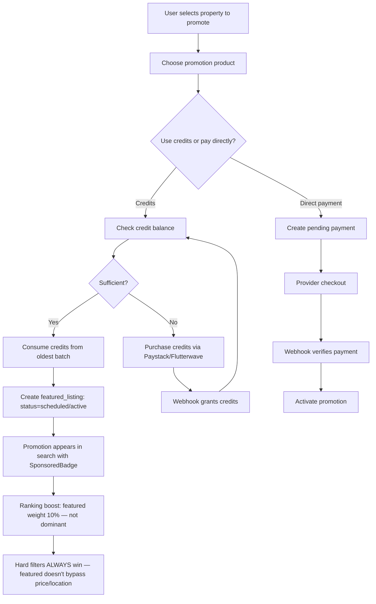

# FEATURED LISTINGS

This document records the featured listings & paid promotion system.

## Architecture overview



## No pay-to-win (spec Section 3)

Featured status is a **controlled visibility boost**, not a dominant ranking signal:
- Featured weight = 10% of the total ranking score
- Freshness weight = 30% (the dominant signal)
- Featured is a **tie-breaker** — it helps when other signals are similar
- Featured **never overrides** hard search filters (price, location, bedrooms, etc.)

A featured property outside the user's price range will NOT appear in results.

## Promotion products (spec Section 5, 13)

Configurable via `promotion_products` table (migration 0022). Each product defines:
- `slug` — unique identifier
- `label` — human-readable name
- `placement` — homepage | search | category | location
- `credit_cost` — credits required
- `duration_days` — promotion length

Default products seeded (⚠️ values require final business approval):
- Search Boost 7 days (1 credit)
- Search Boost 14 days (2 credits)
- Search Boost 30 days (3 credits)
- Homepage Featured 7 days (2 credits)
- Homepage Featured 14 days (4 credits)
- Location Featured 7 days (1 credit)
- Location Featured 14 days (2 credits)

## Credit system (spec Section 9, 10)

### Append-only ledger
`featured_credit_transactions` table — every credit change is recorded:
- `granted` — plan allocation or admin grant
- `consumed` — used for a promotion
- `refunded` — promotion cancelled before start
- `expired` — credits expired (future)
- `purchased` — bought via payment
- `adjusted` — admin adjustment

### Credit balance
Derived from `featured_listing_credits` table (sum of `remaining` where not expired).

### No negative balances
`CHECK (remaining >= 0)` at DB level prevents negative balances.

### Included credits (spec Section 11)
From the subscription capability system:
- Landlord Free: 0, Pro: 1, Premium: 3
- Agent: 0 (agents don't list properties)
- Company Free: 0, Pro: 2, Premium: 5

### Purchased credits (spec Section 12, 15)
- Price: ₦2,000 per credit (⚠️ requires business approval)
- Payment via existing Paystack/Flutterwave abstraction
- After webhook verification: `grantPurchasedCredits()` creates credit row + ledger entry
- **Idempotent**: checks if credits already granted for this payment before granting again

## Promotion lifecycle (spec Section 6, 14)

```
pending_payment → scheduled → active → completed/expired
                                ↓
                           paused → active
                                ↓
                           cancelled (credits refunded if pre-start)
```

### Eligibility (spec Section 7, 8)
Server-side checks before creating a promotion:
1. User is authenticated + active
2. User owns or manages the property (owner/creator/managing_agent)
3. Property is published + not deleted/suspended
4. Property status is available/application_pending/under_offer
5. Promotion product exists + is active
6. User has not exceeded max simultaneous active promotions (10)
7. Credits sufficient (if using credits) OR payment initiated (if direct payment)

### Cancellation (spec Section 27)
- Scheduled promotions: credits refunded + ledger entry recorded
- Active promotions: promotion ends immediately, no credit refund
- Promotion is NOT deleted — status changed to `cancelled`

## Search integration (spec Section 20, 21)

The ranking system (`ranking.ts`) has a `featured` signal:
- `computeFeatured()` returns 1.0 if the property has an active featured promotion, 0.0 otherwise
- Featured weight = 0.10 (10% of total score)
- Featured properties are identified by checking the `featured_listings` table for active promotions matching the search placement
- **Hard filters always win**: the search query applies ALL filters (price, location, beds, etc.) BEFORE ranking. A featured property outside the price range is excluded.

## Public display (spec Section 19)

- `SponsoredBadge` component: "Featured" or "Sponsored" label with gold accent
- Featured properties in search results show the badge
- Homepage featured section (future: `getHomepageFeaturedListings()` fetcher is ready)

## Dashboard (spec Section 25, 26)

`/dashboard/promotions`:
- Credit balance + recent transactions
- Promotion list with status badges, dates, impressions/clicks
- Buy credits dialog (amount selector + Paystack redirect)
- Cancel promotion confirmation dialog

## RLS (spec Section 34)

| Table | User access | Server access |
|---|---|---|
| `featured_listings` | READ (public for active, own for all) | Full (service-role) |
| `featured_listing_credits` | READ own only | Full (service-role) |
| `featured_credit_transactions` | READ own only | Full (service-role, INSERT only) |
| `promotion_products` | READ (public) | — |
| `promotion_impressions` | NONE (server-side only) | Full (service-role) |

Users CANNOT: assign themselves credits, modify credit balances, mark promotion active, extend dates, change pricing, promote another user's property, modify analytics.

## Verification + reputation separation (spec Sections 29, 30)

- Featured listing does NOT receive verification badge
- Featured listing does NOT increase star rating or review count
- These are completely separate systems

## Analytics foundation (spec Sections 31, 32)

`promotion_impressions` table:
- `event_type`: impression | click
- `session_hash`: anonymous session hash for click dedup
- Unique index on (featured_listing_id, session_hash, hour) for click dedup
- No personal information stored

## Audit events (spec Section 36)

- `promotion_created`
- `promotion_cancelled`
- `featured_credit_purchased`
- No secrets in audit metadata

## Future extension points

- Admin dashboard for approve/reject promotions
- Homepage featured carousel component
- Location-targeted featured display
- Category-targeted featured display
- Promotion analytics dashboard
- Recurring promotion subscriptions
