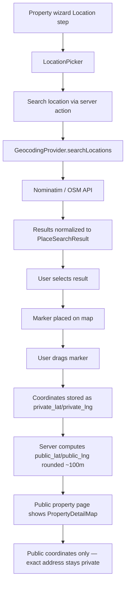

# MAPS

This document records the maps + location intelligence system.

## Architecture overview



## Map provider

**OpenStreetMap (Leaflet + Nominatim)** — free, no API key required.

The provider is behind two interfaces:

1. **MapProvider** (`src/lib/maps/index.ts`) — tile URLs, static map images, attribution. Established in Phase 2.
2. **GeocodingProvider** (`src/lib/maps/geocoding.ts`) — geocode, reverseGeocode, searchLocations. Added in Phase 8.

Both use the singleton pattern — swap by replacing the export. No call-site changes needed.

### Geocoding provider

```
GeocodingProvider (interface)
├── NominatimProvider — OpenStreetMap's free geocoding API
└── StubGeocodingProvider — dev/test fallback (no external calls)
```

In production: `NominatimProvider` (uses Nominatim's search/reverse endpoints with `countrycodes=ng` for Nigeria focus).
In development: `StubGeocodingProvider` (returns empty results — no external API calls during dev).

### Server actions

All geocoding happens server-side via server actions (`src/lib/maps/server-actions.ts`):
- `searchLocationsAction(query)` — rate-limited (10/min per IP), debounced client-side (300ms, min 3 chars)
- `geocodeAddressAction(address)` — rate-limited (5/min)
- `reverseGeocodeAction(lat, lng)` — rate-limited (10/min)

Per spec Section 6 + 32: never call provider APIs directly from React components.

## Public/private location strategy (spec Section 7 + 8)

| Field | Stored in | Exposed publicly? | Notes |
|---|---|---|---|
| `private_lat` / `private_lng` | `property_locations` | **NO** | Exact coordinates — only the owner + managing agent + admin |
| `public_lat` / `public_lng` | `property_locations` | Yes | Rounded to ~100m (3 decimal places ≈ 111m) |
| `address_line` | `property_locations` | **NO** | Private exact street address |
| `address_lga` | `property_locations` | **NO** | LGA of the private address |
| `state`, `city`, `area`, `landmark` | `property_locations` | Yes | Public location text |

### Deterministic obfuscation (spec Section 8)

`deterministicPublicCoordinate(privateLat, privateLng, propertyId)` in `src/lib/maps/public-coords.ts`:

1. Rounds to 3 decimal places (~111m grid cell)
2. Adds a deterministic offset within the cell, derived from a hash of the property ID
3. The offset is at most ~33m — so the public marker stays within ~111m of the real location
4. The offset is **stable** — same property ID always produces the same public coordinate

This means the public marker doesn't jump around on every page load (spec: "Do not randomly offset coordinates on every page load").

## Components

### InteractiveMap (`src/components/maps/interactive-map.tsx`)

Core Leaflet wrapper — client-only (dynamically imported with `ssr: false` where needed).

Features:
- OpenStreetMap tiles (free, no API key)
- Custom property markers (green teardrop shape)
- Draggable marker mode (for location picker)
- Multiple markers mode (for search results)
- Viewport change handler (debounced 500ms — for bounds-based search)
- Error boundary — if Leaflet fails to load, renders "Map unavailable" fallback
- Accessible: `role="region"`, `aria-label="Property map"`, text fallbacks

### LocationPicker (`src/components/maps/location-picker.tsx`)

Search + draggable marker for the property wizard:
- Debounced location search (300ms, min 3 chars)
- Search results dropdown with display name + description
- Map with draggable marker
- Selected coordinates display
- Manual coordinate entry fallback (collapsible `<details>` element)

### PropertyDetailMap (`src/components/maps/property-detail-map.tsx`)

Read-only map for the public property page:
- Shows "Approximate location" label
- Uses `public_lat` / `public_lng` (already obfuscated)
- Falls back to text-only location if no coordinates
- "Exact address is shared only after you contact the lister" notice

### SearchResultsMap (`src/components/maps/search-results-map.tsx`)

Map for the `/properties` search page (map/split view):
- Renders all search results as markers
- Marker popups show title, price, location, "View property" link
- Falls back to "No properties with map coordinates found" when no geolocated results
- Viewport change handler (for future bounds-based search)

## List / Map / Split view toggle (spec Section 11)

The `/properties` search page has three view modes:
- **List** (default) — property cards in a responsive grid
- **Map** — full-width map with markers from the current search results
- **Split** (desktop only, hidden on mobile) — list + map side by side

All three modes respect the same active filters — the map is NOT a separate search system.

## Coordinate validation (spec Section 17)

`src/lib/maps/coordinate-validation.ts`:

| Check | Rule |
|---|---|
| Latitude | -90 to 90 (inclusive) |
| Longitude | -180 to 180 (inclusive) |
| Coordinate pair | Both must be set or both null |
| Bounding box | North > South, East > West, all within valid ranges |
| Nigeria bounds | lat 4.2–13.9, lng 2.7–14.7 (advisory, not blocking) |

## Viewport search foundation (spec Section 13)

The `SearchResultsMap` component accepts an `onViewportChange` callback that fires when the map viewport changes (debounced 500ms). The callback receives a bounding box `{ north, south, east, west }`.

The search params module (`src/lib/search/params.ts`) has a `parseBoundingBox()` function ready to parse `?bounds=north,south,east,west` from the URL. The query builder can apply this as a geographic filter on `public_lat` / `public_lng`.

In V1, viewport search is prepared but not fully wired to avoid sending a request on every tiny map movement. The architecture is ready for P9+ to enable it.

## Cost control (spec Section 21)

| Measure | Implementation |
|---|---|
| No geocoding on every render | Server actions cache results; client stores coordinates in the property row |
| No repeated reverse geocoding | Stored as `private_lat`/`private_lng` in the DB |
| No search API requests per keystroke | Debounced 300ms client-side + rate-limited 10/min server-side |
| No recreating maps unnecessarily | Map components are dynamically imported; Leaflet CSS loaded once at module level |
| No duplicate location requests | Location data stored in `property_locations` table (written once at publish time) |

## Privacy + security (spec Sections 7, 25, 26)

- Private exact coordinates (`private_lat`/`private_lng`) + `address_line` are **never** returned by the public property fetcher (`getPublicProperty()`)
- RLS on `property_locations` follows the property's access pattern — public reads only see `public_lat`/`public_lng` + area/city/state/landmark
- Server actions derive identity from `getCurrentUser()` / `getCurrentProfile()` — never from client-supplied userId
- Geocoding server actions are rate-limited per IP
- No Supabase service-role credentials or maps server secrets exposed to the browser
- The `MAPS_PROVIDER_KEY` env var is server-only (never `NEXT_PUBLIC_*`)

## Accessibility (spec Section 28)

- Maps are never the ONLY way to access location information
- Property detail pages show text location ("Garki, Abuja, FCT") alongside the map
- Map container has `role="region"` + `aria-label="Property map"`
- List view works fully without the map
- Keyboard users can navigate property results without interacting with the map
- If the map fails to load, text location is still shown

## Error states (spec Section 29)

| Error | Handling |
|---|---|
| Map provider unavailable | Error boundary catches → "Map unavailable" fallback |
| Invalid API key | N/A (OSM is free, no key) |
| Geocoding failure | Server action returns `null` — UI shows "No results" |
| Location search failure | Empty results dropdown — user can try again |
| No location found | Text-only fallback section |
| Browser geolocation denied | Not requested (per spec Section 24 — only when user opts in) |
| Network failure | Error boundary + text fallback |
| Invalid coordinates | Rejected by `validateCoordinatePair()` at publish time |

## Routes

| Route | Map integration |
|---|---|
| `/properties` | List/Map/Split view toggle; map respects active filters |
| `/properties/[id]` | `PropertyDetailMap` section with "Approximate location" label |
| `/dashboard/properties/new` | `LocationPicker` in the Location step of the wizard |
| `/dashboard/properties/[id]/edit` | (Same LocationPicker can be added to the edit form) |

## Future work

- Viewport-based search (bounds parameter fully wired to the query builder)
- "Use my location" / "Properties near me" (requires explicit user opt-in per spec Section 24)
- PostGIS spatial indexes (if distance-based search is needed — current coordinates support basic bounding-box queries without PostGIS)
- Google Maps / Mapbox provider (swap the singleton export — no call-site changes)
- Nearby context (universities, hospitals, shopping areas) — requires POI data from the provider
- Marker clustering for large result sets (Leaflet clustering plugin)
