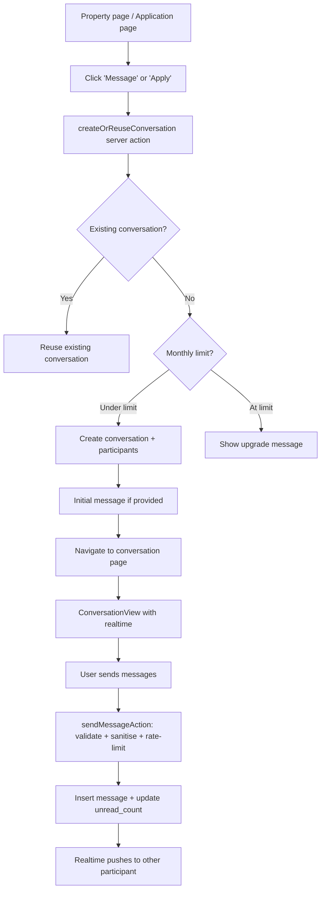

# MESSAGING

This document records the secure messaging & communication system.

## Architecture overview

## Conversation model (spec Section 4)

`conversations` table (migration 0014) — normalized multi-party model:
- `property_id` — optional property context
- `application_id` — optional linked application
- `conversation_type` — `marketplace` | `application` | `support`
- `last_message_at` + `last_message_id` — for inbox sorting + preview

## Participant model (spec Section 5)

`conversation_participants` (migration 0014):
- `conversation_id` + `user_id` (composite PK)
- `last_read_message_id` — per-participant read cursor
- `unread_count` — efficient unread count (no message COUNT query)
- `archived_at` — per-participant soft-archive
- `muted` — suppress notifications (future)

Supports future multi-party conversations — not limited to 1:1.

## Message model (spec Section 6)

`messages` (migration 0014):
- `message_type` — text | image | file | system | property_share (V1 uses text + system)
- `body` — plain text (HTML-escaped server-side, never `dangerouslySetInnerHTML`)
- `deleted_at` — soft deletion (spec Section 23: "Users should NOT be able to permanently delete")
- `edited_at` — reserved for future editing (spec Section 22: not implemented in V1)
- `status` — sent | delivered | read
- `sender_id` — derived from server session, never client-supplied

## Conversation creation (spec Sections 9, 10)

`createOrReuseConversation()`:
1. Derives identity from `getCurrentUser()` + `getCurrentProfile()`
2. Verifies account is active (spec Section 42)
3. Verifies recipient exists + is not banned/deleted
4. **Verification restriction** (spec Section 29): agents/companies on Free/Pro plans can only start new conversations with verified users (bronze/blue). Checked server-side — never client-supplied `isVerified`.
5. **Duplicate prevention** (spec Section 10): checks for existing conversation with same participants + same property context. If found → reuse, don't create duplicate.
6. **Monthly limit** (spec Section 27, 28): counts NEW conversations started this month. Does NOT count: receiving messages, replying, reading, system messages.
7. **Rate-limited**: 10 conversation creations/hour per user (spec Section 31)
8. Creates conversation + inserts 2 participant rows
9. Sends initial message if provided
10. Audit log: `conversation.create` (metadata only — no message body)

## Monthly conversation limits (spec Section 27)

| Role | Plan | New conversations/month |
|---|---|---|
| Landlord | All plans | Unlimited (they receive inquiries) |
| Agent | Free | 10 |
| Agent | Pro | 25 |
| Agent | Premium | 500 (fair-use ceiling) |
| Company | Free | 15 |
| Company | Pro | 25 |
| Company | Premium | 500 (fair-use ceiling) |

**Critical (spec Section 26)**: limits apply to STARTING new conversations only. Existing legitimate conversations remain usable even after the limit is reached. No conversation is blocked or destroyed.

## Verification restrictions (spec Section 29)

Agents and companies on Free/Pro plans can only start NEW conversations with verified users (bronze or blue badges). Checked server-side:
- Reads `recipient.verification_state` from the database
- If recipient is unverified AND caller is an unverified agent/company on Free/Pro → rejected with "Get verified or upgrade to Premium"
- Never trusts client-supplied `isVerified = true`

## Message sending (spec Sections 7, 8, 11)

`sendMessageAction()`:
1. Derives `sender_id` from server session (`profile.id`) — never client-supplied
2. Verifies the caller is a participant in the conversation
3. Verifies account is active
4. Rate-limited: 60 messages/hour per user (spec Section 31)
5. Validates body: non-empty, max 5000 chars (spec Section 8)
6. Sanitises: HTML-escapes `&`, `<`, `>` (spec Section 7: "Never render user messages using unsafe `dangerouslySetInnerHTML`")
7. Inserts with `sender_id = profile.id` (server-controlled)
8. Updates conversation `last_message_at` + `last_message_id`
9. Increments `unread_count` for other participants (spec Section 17: efficient, no COUNT query)
10. Realtime: Supabase Realtime pushes the new row to subscribed participants

## Realtime messaging (spec Sections 14, 15)

`ConversationView` client component:
- Subscribes to `postgres_changes` on the `messages` table filtered by `conversation_id`
- Receives INSERT events → appends to message list (with duplicate protection)
- Connection status shown ("Live" indicator)
- **Unsubscribes on unmount** (spec Section 14: "Cleanup when leaving the conversation")
- **RLS-enforced** (spec Section 15): Supabase Realtime respects RLS — a user only receives events for conversations they're a participant in

## Read status + unread counts (spec Sections 16, 17)

- `conversation_participants.last_read_message_id` — per-participant read cursor
- `conversation_participants.unread_count` — incremented when others send, reset to 0 on `markConversationReadAction()`
- Inbox shows unread badge: `unread_count > 0` → small primary-colored pill with count
- Efficient: no `COUNT(*)` query on the messages table for unread counts

## Pagination (spec Section 21)

- Initial load: newest 30 messages (reversed for chronological display)
- "Load earlier messages" button: fetches 30 messages before the oldest currently loaded
- Cursor-based: uses the oldest message's `created_at` as the cursor
- +1 query trick: fetches 31 to check `hasMore`

## Inbox (spec Section 18)

`/dashboard/messages`:
- Conversations sorted by `last_message_at DESC`
- Each item: other participant avatar + name + verification badge, last message preview (80 chars), timestamp, unread count badge, property context (if applicable)
- Excludes archived conversations
- Efficient: batch fetches all participants + last messages (no N+1)

## Conversation page (spec Section 19)

`/dashboard/messages/[conversationId]`:
- Header: other participant name + verification badge + role + "Live" indicator
- Property context bar: "About: [property title]" (if applicable)
- Messages: chronological, sender vs other participant differentiation, system messages centered
- Safety notice (compact) for property-related conversations (spec Section 33)
- Composer: textarea + send button, Enter-to-send, Shift+Enter for newline, character counter
- Back button on mobile
- Auto-scroll to latest message
- Validates participation before rendering (spec Section 19: "must validate that the current user is a participant")

## System messages (spec Section 13)

System messages are generated server-side only — users cannot impersonate them. The `message_type = 'system'` value is set by the server when inserting application/representation event messages. System messages render centered with muted styling.

## Block / report (spec Sections 24, 25)

- `reportConversationAction()` — inserts into the existing `reports` table with `entity_type='message'`
- `blockUserAction()` — inserts into `conversation_blocks` table (UNIQUE on blocker_id + blocked_id)
- **Blocking prevents new conversations** but does NOT destroy existing conversation history (spec Section 25: "Do not abruptly destroy existing legitimate conversation history")
- Rate-limited: 10 reports/hour

## Message content safety (spec Section 32)

- Length validation (5000 chars max, server-enforced)
- HTML escaping (prevents XSS)
- Rate limiting (60 messages/hour)
- Reporting extension point
- No over-aggressive automated moderation (spec: "Do not implement an over-aggressive automated moderation system that blocks normal Nigerian property conversations")

## Contact restrictions (spec Section 26)

Messaging is marketplace-oriented:
- No global "message anyone" button
- Conversations created from property pages, agent applications, or representation relationships
- Eligibility checked server-side before conversation creation
- Verification restrictions enforced for Free/Pro plans

## RLS (spec Section 35)

| Table | Read | Write |
|---|---|---|
| conversations | Only participants (via participant subquery) | Only participants |
| conversation_participants | Own participant info + other participants in shared conversations | Own participant row only |
| messages | Only in conversations the user is a participant of | Only as themselves (sender_id verified), only in their conversations |
| conversation_blocks | Own blocks + who blocked them | Own blocks only |

## Audit events (spec Section 37)

Metadata only — no message bodies in audit logs:
- `conversation.create` — new conversation created
- `message.soft_delete` — message soft-deleted
- `conversation.block` — user blocked

## Components

| Component | Location | Purpose |
|---|---|---|
| `ConversationView` | `src/components/messaging/conversation-view.tsx` | Full conversation UI with realtime + pagination + composer |
| `MessageComposer` | `src/components/messaging/message-composer.tsx` | Text input + send button with Enter-to-send |
| `InboxList` | `src/components/messaging/inbox-list.tsx` | Inbox conversations list with unread badges |
