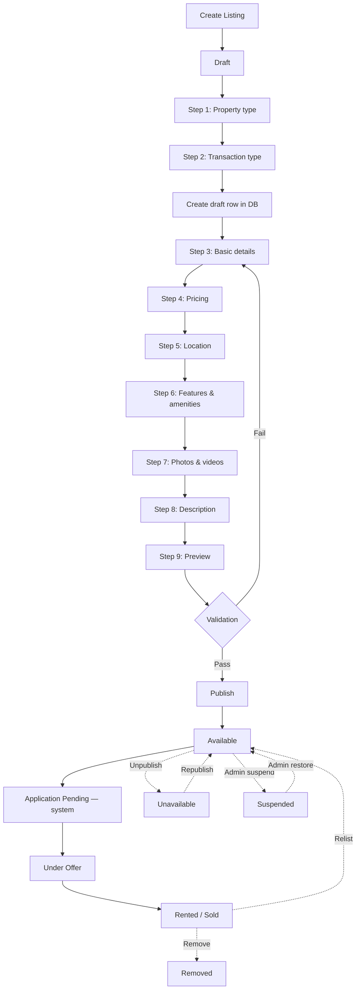

# PROPERTIES

This document records the property listing + management system as actually implemented.

## Architecture overview



## Ownership model (spec Section 26)

The `properties` table has **three distinct columns** for ownership / management:

| Column | Purpose | Set by |
|---|---|---|
| `owner_profile_id` | The actual property owner (landlord or company) | Always set at creation. For self-listings, equals `listing_creator_id`. |
| `listing_creator_id` | Who published the listing | Always set at creation. Cannot be changed from the client (RLS UPDATE policy). |
| `managing_agent_id` | The agent currently representing the property | Initially null. Set when an agent's application is accepted (P5 — agent applications). |

This separation lets us model "agent publishes on behalf of owner" (future feature) without collapsing ownership into a single `user_id`.

### Who can list?

- **Landlords**: create listings of properties they own. `maxListingsPerMonth` per plan (Free: 5, Pro: 25, Premium: 500 fair-use ceiling).
- **Companies**: create listings of company-owned properties. Limits per plan (Free: 10, Pro: 20, Premium: 500 fair-use ceiling).
- **Agents**: CANNOT create listings. `maxListingsPerMonth = 0` for all agent plans. Agents apply to represent existing listings — they don't list their own.

The capability system in `src/lib/capabilities/index.ts` is the single source of truth.

## Property types (spec Section 4)

26 property types seeded via `supabase/seed/001_property_types.sql`, grouped into 6 categories:

- **Residential**: apartment, house, duplex, bungalow, terrace, detached_house, semi_detached_house, mansion, penthouse, shortlet
- **Commercial**: office, shop, commercial_building, hotel, guest_house, event_center, school, hospital
- **Industrial**: warehouse, industrial_land
- **Land**: farmland, residential_land, commercial_land, industrial_land
- **Mixed-use**: mixed_use, estate
- **Other**: other

The `property_types` table is extensible — admins can add new types without code changes. The wizard groups types by category for easy picking.

## Transaction types (spec Section 5)

| Type | Pricing rules |
|---|---|
| `rent` | Must have `price_frequency` of `per_month` or `per_year` |
| `sale` | Must have `price_frequency = "one_off"` (total) |
| `shortlet` | `price_frequency` of `per_night`, `per_day`, `per_week`, or `per_month` |

DB CHECK constraint + Zod schema both enforce these rules.

## Listing lifecycle (spec Section 24)

| Status | Public? | Meaning |
|---|---|---|
| `draft` | No | User is still filling in details |
| `available` | Yes | Published and accepting inquiries |
| `application_pending` | Yes | At least one agent has applied to represent |
| `under_offer` | Yes | Negotiation in progress |
| `rented` | Yes (with status indicator) | Property has been rented |
| `sold` | Yes (with status indicator) | Property has been sold |
| `unavailable` | No | Manually paused by owner |
| `suspended` | No | Admin suspended the listing |
| `removed` | No | Soft-deleted by owner or admin |

Allowed transitions are defined in `src/lib/properties/status-machine.ts`. The `canTransition()` function is the single check used by all status-change server actions.

### Critical status rules

- `removed` → `available` requires **admin** (per spec Section 23)
- `suspended` → `available` requires **admin**
- `available` → `suspended` requires **admin** (owners cannot self-suspend)
- `available` → `application_pending` is **system-only** (triggered when an agent applies)

## Media system (spec Sections 16, 17, 18, 19)

### Storage bucket

`property-media` (defined in `supabase/migrations/0006_property_media_and_amenities.sql` + `0018_storage_policies.sql`)

- **Path**: `{property_id}/{uuid}.{ext}`
- **Public read**: yes (RLS allows anon + authenticated reads of published-listing media)
- **Write**: only property managers (via `can_manage_property()` SECURITY DEFINER helper)
- **Delete**: only property managers

### File validation

`src/lib/storage/file-validation.ts` enforces:

1. Magic-byte MIME sniffing (JPEG, PNG, WebP, PDF)
2. Extension blocklist (`.exe`, `.bat`, `.sh`, `.svg`, `.zip`, etc.)
3. Extension allowlist (`.jpg`, `.jpeg`, `.png`, `.webp`, `.pdf` for documents; same minus PDF for avatars)
4. Size limits: 10 MB for documents, 5 MB for avatars
5. Client-reported MIME cross-check (sniffed type wins; mismatches logged)

### Subscription-based limits (spec Section 17)

| Role | Plan | Photos | Videos |
|---|---|---|---|
| Landlord | Free | 5 | 0 |
| Landlord | Pro | 25 | 2 |
| Landlord | Premium | unlimited (fair-use 100) | unlimited (fair-use 10) |
| Company | Free | 3 | 0 |
| Company | Pro | 5 | 2 |
| Company | Premium | unlimited (fair-use 100) | unlimited (fair-use 10) |
| Agent | (any) | 0 | 0 |

Enforced server-side in `uploadPropertyMedia()` via the capability system. The client-side wizard also displays limits.

## Validation rules (spec Section 38)

`src/lib/properties/validation.ts` defines Zod schemas per step + a full-property publish schema. Validation adapts to property type:

- **Land**: `bedrooms` defaults to 0 (not required), `furnished_status` hidden
- **Residential**: all bedrooms/bathrooms/toilets relevant
- **Commercial**: bedrooms irrelevant (default 0)
- **Short-let**: `price_frequency` supports `per_night`

The full publish schema enforces:
- Title ≥10 chars, ≤200 chars, no leading/trailing whitespace
- Description ≤5000 chars
- Price is a non-negative integer ≤₦1,000,000,000 (in kobo — minor units)
- Coordinates in valid ranges (-90 to 90, -180 to 180)
- Both lat + lng must be set together, or neither
- State + city required
- Sale listings must have `price_frequency = "one_off"`
- Rent/shortlet listings must have a non-null `price_frequency`

## Anti-spam / quality controls (spec Sections 8, 39)

`src/lib/properties/anti-spam.ts`:

### Title quality check

`checkTitleQuality(title)` returns one of:

| Quality | Trigger |
|---|---|
| `clean` | No issues |
| `too_short` | <10 chars |
| `too_long` | >200 chars |
| `suspicious_caps` | >50% uppercase letters AND >10 alpha chars |
| `excessive_punctuation` | 5+ punctuation marks in a row |
| `spam_pattern` | Contains urgency / crypto / giveaway / dollar-sign / direct-contact language |

Spam patterns flagged:
- `cheapest`, `best price`, `urgent sale`, `must sell`, `quick sale`
- `call now`, `whatsapp me`, `dm me`, `inbox me`
- `$$$`, `$N` (dollar signs)
- `crypto`, `bitcoin`, `investment opportunity`, `double your money`
- `free`, `giveaway`, `bonus`, `promo`, `discount`
- 5+ of the same character in a row

Publishing is **blocked** if `title_quality === "spam_pattern"`. Other quality flags allow publishing but show up in the admin moderation queue.

### Description sanitisation

`sanitizeDescription(description)`:
- Escapes `&`, `<`, `>`, `"`, `'` (prevents HTML injection)
- Strips `script:` patterns
- Trims whitespace

Per spec Section 9: HTML submitted by clients is NEVER trusted. The frontend renders the description as plain text with line breaks.

## Publishing rules (spec Section 22)

Server-side `publishProperty()` enforces:

1. Caller is authenticated + active + onboarding-complete
2. Caller owns or manages the property (via `getActorRole()`)
3. Property status is `draft` or `unavailable` (can only (re)publish from these states)
4. Title is not flagged as `spam_pattern`
5. All required fields pass `fullPropertyPublishSchema` validation:
   - Title ≥10 chars
   - Property type set
   - Transaction type set
   - Price > 0
   - Price frequency matches transaction type
   - State + city set
   - Coordinates valid (if set)
6. At least 1 photo uploaded
7. Status transition is authorised via `canTransition()`

If all checks pass, the property is updated: `status = 'available'`, `published_at = now()`.

## Public property page (spec Section 32)

`/properties/[id]` — fetches via `getPublicProperty()` (in `src/lib/properties/public-fetcher.ts`).

### Public-safe fields returned

| Field | Exposed? | Notes |
|---|---|---|
| `id`, `title`, `description` | Yes | |
| `transactionType`, `price`, `priceFrequency`, `currency` | Yes | |
| `bedrooms`, `bathrooms`, `toilets`, `parkingSpaces`, `yearBuilt`, `floors` | Yes | |
| `furnishedStatus`, `sizeValue`, `sizeUnit` | Yes | |
| `status`, `publishedAt`, `createdAt` | Yes | |
| `propertyType` (slug, label, category) | Yes | |
| `location.country/state/city/area/landmark` | Yes | Public location only |
| `location.publicLat/publicLng` | Yes | Rounded to ~100m |
| `location.addressLine/addressLga` | **NO** | Private exact address — released only after inquiry |
| `location.privateLat/privateLng` | **NO** | Private exact coordinates |
| `media` (storage_path → public URL, caption, alt_text, sort_order, is_featured) | Yes | For published listings only |
| `amenities` (id, slug, label, category) | Yes | |
| `listedBy.id/role/fullName/avatarUrl/verificationState` | Yes | |
| `listedBy.professionalName/agencyName` (agent) | Yes | |
| `listedBy.companyName/companyLogoUrl/officeState/website` (company) | Yes | |
| `listedBy.socialHandles` | Yes, **only if capability allows (Premium)** | Stripped to null otherwise |
| `listedBy.phone/email` | **NO** | Only via messaging system |
| `listedBy.subscription_tier` | **NO** | Only the capability derivation is public |

### Listed-by hiding

Listings by banned / soft-deleted / non-onboarded profiles return `null` — the public page shows "Property not found". This prevents stale listings from appearing for fraudulent or suspended accounts.

## Property inventory dashboard (spec Section 30)

`/dashboard/properties` — Server Component that fetches properties the caller owns, created, or manages.

Per-property card shows:
- Featured image (or Building2 icon placeholder)
- Title
- Status badge (color-coded)
- Price + frequency suffix
- Location (area, city, state)
- Transaction type + property type label

Action menu (visible per current status):
- Draft / Unavailable → "Publish" button
- Available / Application pending / Under offer → "Unpublish", "Mark rented", "Mark sold", "Mark unavailable", "Remove"
- Rented / Sold → "Make available", "Mark unavailable", "Remove"

All actions call the status-machine-gated `changePropertyStatus()` server action.

## Reporting (spec Section 34)

`/properties/[id]` page includes a "Report listing" button that opens a dialog. The dialog calls `reportProperty()` in `src/lib/properties/media-actions.ts`, which:

- Validates reason (one of: fake_listing, scam_attempt, wrong_property_info, already_sold_rented, fraudulent_agent, fraudulent_owner, suspicious_payment_request, inappropriate_content, other)
- Validates description ≥10 chars
- Rate-limits (10 reports per hour per user)
- Inserts into the existing `reports` table with `entity_type='property'`, `entity_id={propertyId}`

No duplicate reporting system — reuses the infrastructure from migration 0016.

## Audit history (spec Section 37)

Every property action calls `record_audit()` (or directly inserts into `audit_logs`) with:

- `actor_id` — the auth user performing the action
- `action` — one of: `property.create_draft`, `property.publish`, `property.unpublish`, `property.status_change`, `property.media_upload`, `property.media_delete`, `property.report`
- `target_type='property'`
- `target_id={propertyId}`
- `metadata={...}` — action-specific context

The audit table is append-only — users cannot modify audit records (no UPDATE/DELETE RLS policy).

## RLS + storage policies

From earlier migrations (0005, 0006, 0018):

- `properties`: SELECT policy allows public reads of published (non-deleted, non-draft, non-suspended, non-removed) listings; owners/creators/managing agents can read all their own.
- `property_locations`: SELECT follows property access (public for published; private for drafts).
- `property_media`: SELECT for published listings; INSERT/UPDATE/DELETE only for property managers via `can_manage_property()`.
- `property_amenities`: same pattern.
- Storage bucket `property-media`: policies use `can_manage_property()` to verify ownership without recursive RLS.

## File structure

```
src/lib/properties/
├── validation.ts          — Zod schemas per step + full-publish schema
├── status-machine.ts      — STATUS_TRANSITIONS + TRANSITION_ACTORS + canTransition()
├── anti-spam.ts           — checkTitleQuality() + sanitizeDescription()
├── actions.ts             — createPropertyDraft, updatePropertyStep, publishProperty, changePropertyStatus + status-action wrappers
├── media-actions.ts       — uploadPropertyMedia, deletePropertyMedia, reorderPropertyMedia, setFeaturedPropertyMedia, reportProperty
├── public-fetcher.ts      — getPublicProperty() (public-safe fields only)
└── reference-data.ts      — getPropertyTypes(), getAmenities() (master list fetchers)

src/components/properties/
├── property-wizard.tsx            — 10-step creation wizard
├── property-edit-form.tsx         — single-page edit form with all sections
├── property-card.tsx              — used in inventory dashboard
└── report-property-dialog.tsx    — report-this-listing dialog

src/app/dashboard/properties/
├── page.tsx                  — inventory dashboard
├── new/page.tsx              — wizard entry
└── [id]/edit/page.tsx        — edit form

src/app/(marketplace)/properties/[id]/page.tsx — public property page
```

## Future work

- Image optimisation via Next.js Image component (currently uses raw `` for simplicity — fine for foundation; swap to `<Image>` when ready)
- Video magic-byte sniffing (currently relies on extension + client MIME for videos)
- Saved properties / searches (P3 — saved items)
- Property search + filtering (P3 — search & discovery)
- Maps integration (P3)
- Agent applications (P5)
- Featured listing credits (P11)
