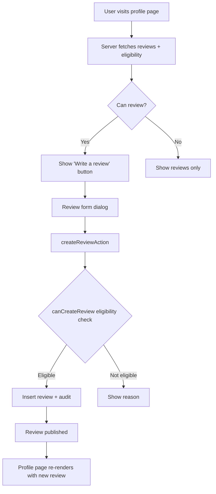

# REVIEWS

This document records the reviews, ratings & reputation system.

## Architecture overview

## Core principle (spec Section 2)

Reviews are NOT freely available. A user must have a **qualifying marketplace interaction** before they can review another user. This prevents fake, retaliatory, spam, duplicate, or coordinated reviews.

### Qualifying interactions

| Type | How it qualifies | DB source |
|---|---|---|
| Accepted application | Agent applied + owner accepted | `property_applications` (status=accepted/completed) |
| Active/ended representation | Agent represented owner's property | `property_agent_representations` (status=active/ended) |
| Existing conversation | Two users have a shared conversation | `conversation_participants` |

The eligibility service (`canCreateReview()`) is extensible — new qualifying interaction types can be added by extending `findQualifyingInteractions()`.

## Who can review whom (spec Section 3)

- Landlord → Agent (after accepted application or representation)
- Agent → Landlord (after accepted application or representation)
- User → Company (after accepted application or conversation)
- Company → Agent (after accepted application or conversation)
- Agent → Company (after accepted application or conversation)

The exact eligible combinations are centralized in `canCreateReview()` — not scattered across UI components.

## Verification ≠ Rating (spec Section 14)

Verification and reputation are **separate systems**:
- A verified agent may have poor reviews
- An unverified user may have legitimate reviews
- A Bronze or Blue badge **never** automatically increases a rating
- Subscription tier does **NOT** affect ratings

Profile pages display verification badges and ratings in **separate** visual sections.

## Review data model (spec Section 4)

`reviews` table (migration 0013 + 0021):
- `reviewer_id`, `reviewed_id` — FK to profiles
- `reviewed_entity_type` — landlord | agent | company (CHECK constraint)
- `application_id`, `conversation_id`, `property_id` — qualifying interaction refs
- `rating` — 1-5 (CHECK constraint, whole numbers)
- `title`, `body` — review content (HTML-escaped server-side)
- `status` — pending | published | hidden | removed
- `response_text`, `response_at` — reviewee response
- `moderation_reason`, `moderated_by`, `moderated_at` — moderation metadata

## Duplicate prevention (spec Section 8)

Database-level UNIQUE constraints:
- `UNIQUE(reviewer_id, reviewed_id, application_id)` — one review per application interaction
- Partial `UNIQUE(reviewer_id, reviewed_id, conversation_id)` — one review per conversation interaction
- Partial `UNIQUE(reviewer_id, reviewed_id, property_id)` — one review per property (when no application)

Server action also pre-checks for better error messages.

## One review per qualifying interaction (spec Section 8)

`canCreateReview()` checks all qualifying interactions between the reviewer and reviewee. If ALL interactions already have reviews, the user cannot review again. If at least one interaction has no review, the user is eligible.

## Review eligibility (spec Section 7)

`canCreateReview()` checks server-side:
1. Reviewer is authenticated
2. Reviewer account is active
3. Reviewee exists + is not banned/deleted
4. Reviewer ≠ reviewee
5. A qualifying interaction exists
6. No existing review for that interaction
7. (Rate limiting applied at action level)

Never trusts client-provided eligibility.

## Content safety (spec Section 16)

- Body validated: non-empty, min 10 chars, max 3000 chars
- HTML-escaped server-side: `&` → `&amp;`, `<` → `&lt;`, `>` → `&gt;`, `"` → `&quot;`, `'` → `&#39;`
- Never rendered via `dangerouslySetInnerHTML`
- Title max 200 chars (optional, also HTML-escaped)
- No automated content moderation (spec: "Do not attempt an overcomplicated AI review-detection system in V1")

## Aggregation (spec Section 12)

`getAggregateRating()`:
- Average rating (rounded to 1 decimal)
- Total review count
- Distribution (5★ to 1★ counts)
- Excludes hidden/removed reviews
- Does NOT manipulate ratings based on subscription tier

## Review lifecycle (spec Sections 9, 10)

| Status | Meaning |
|---|---|
| `pending` | Auto-published in V1 (future: pending admin review) |
| `published` | Publicly visible |
| `hidden` | Admin-hidden (future) |
| `removed` | Reviewer requested removal (soft — audit trail preserved) |

- Reviewer can edit (title, body, rating) — `edited_at` recorded
- Reviewer can request removal — status → `removed` (never hard-deleted)
- Cannot change reviewer, reviewee, or qualifying interaction

## Reporting (spec Section 17)

`reportReviewAction()`:
- Uses existing `reports` table with `entity_type='review'`
- Report reasons: spam, fake_misleading, harassment, threatening_abusive, personal_information, conflict_of_interest, other
- Prevents duplicate reports (checks for existing report from same reporter)
- Rate-limited: 10 reports/hour

## Privacy (spec Sections 11, 19)

Publicly visible:
- Reviewer display name + avatar + verification badge
- Rating + title + body + date
- Property context (title only, no private address)
- Edited indicator

Never exposed:
- Reviewer phone/email/private address
- Internal moderation notes
- Verification documents
- Private interaction data

## RLS (spec Section 22)

- Published reviews: publicly readable (anon + authenticated)
- Reviewers: can read + edit their own reviews
- Reviewed parties: can read reviews about themselves + respond
- Users: cannot modify another user's review, change reviewer/reviewee identity, bypass eligibility, publish hidden reviews, change moderation status, or manipulate aggregates

## Audit events (spec Section 23)

Metadata only — no review bodies in audit logs:
- `review_created`
- `review_updated`
- `review_removed`
- `review_reported`

## No fake reviews (spec Section 36)

No review seed data in any seed file. No placeholder testimonials. The empty state says "No reviews yet. Reviews appear after verified marketplace interactions."

## Components

| Component | Location | Purpose |
|---|---|---|
| `StarRatingDisplay` | `src/components/reviews/star-rating.tsx` | Display-only star rating (5 stars, filled/empty) |
| `StarRatingInput` | `src/components/reviews/star-rating.tsx` | Interactive star rating input (keyboard accessible, role=radiogroup) |
| `RatingSummary` | `src/components/reviews/review-section.tsx` | Average + count + distribution bars |
| `ReviewCard` | `src/components/reviews/review-section.tsx` | Single review display with reviewer info + property context |
| `ReviewSection` | `src/components/reviews/review-section.tsx` | Section wrapper: summary + review list + load more |
| `ReviewSectionClient` | `src/components/reviews/review-section-client.tsx` | Client wrapper: "Write a review" button + form dialog |
| `ReviewFormDialog` | `src/components/reviews/review-form-dialog.tsx` | Create review modal: star input + title + body + eligibility reason |

## Integration

Profile pages (`/agents/[id]`, `/companies/[id]`, `/landlords/[id]`):
- Server Component fetches `getReviewsForProfile()` + `canCreateReview()` in parallel
- Passes initial reviews + aggregate + eligibility to `ReviewSectionClient`
- Client component renders reviews + "Write a review" button (if eligible) + dialog

## Future extension points

- Admin moderation UI (P15) — review status transitions from `pending` → `published`/`hidden`
- Review responses (spec Section 20) — the `response_text` + `response_at` columns are ready
- Secondary rating dimensions (spec Section 6) — communication/professionalism/reliability
- Search ranking integration (spec Section 28) — the ranking abstraction has a `trust` weight slot
- Notification hooks (P13) — review_created/updated/reported events in audit_logs
