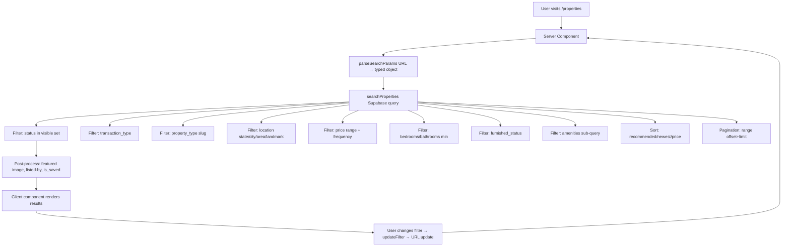

# SEARCH

This document records the property search, filtering, discovery, and saved-items system.

## Architecture overview



## URL-based search state (spec Section 18)

All filters are reflected in the URL query string:

```
/properties?transaction=rent&propertyType=apartment&state=FCT&city=Abuja&minPrice=500000&maxPrice=5000000&bedrooms=3&amenities=parking,security&sort=newest&page=2
```

Supported params:
- `q` — free-text search (min 2 chars)
- `transaction` — rent / sale / shortlet
- `propertyType` — property type slug (e.g. "apartment")
- `state`, `city`, `area`, `landmark` — location filters
- `minPrice`, `maxPrice` — price range (in kobo / minor units)
- `priceFrequency` — one_off / per_day / per_week / per_month / per_year / per_night
- `bedrooms`, `bathrooms` — minimum (1+, 2+, etc.)
- `furnished` — furnished / semi_furnished / unfurnished / not_applicable
- `amenities` — comma-separated amenity slugs
- `status` — available (default) / available_and_pending
- `sort` — recommended (default) / newest / price_low_high / price_high_low / most_relevant
- `page` — 1-indexed page number
- `pageSize` — results per page (default 12, max 24)

`parseSearchParams()` and `serialiseSearchParams()` are the single source of truth for parsing + serialising.

## Server-side query builder

`src/lib/search/query-builder.ts` — `searchProperties()` function:

1. Builds a count query + a data query in parallel
2. Applies visibility filter: `status IN (available, application_pending, under_offer, rented, sold)` + `deleted_at IS NULL` + `published_at IS NOT NULL`
3. Applies each filter via Supabase query builder methods (`.eq()`, `.gte()`, `.ilike()`, `.in()`)
4. Post-processes results: fetches featured image URLs, listed-by profile info, is_saved flags

All queries use Supabase's parameterised query builder — **never** string interpolation.

## Ranking system (spec Section 15)

`src/lib/search/ranking.ts` — `rankProperty()` computes a 0–100 score per property:

| Signal | Weight | Computation |
|---|---|---|
| Freshness | 0.30 | 1.0 if <7 days old; decays to 0.2 after 180 days |
| Completeness | 0.20 | Fraction of key fields filled (title, price, image, location, beds, baths, size, listed-by) |
| Trust | 0.15 | Blue=1.0, Bronze=0.7, Pending=0.3, Unverified=0.0 |
| Availability | 0.25 | Available=1.0, Application_pending=0.7, Under_offer=0.5, Rented/Sold=0.2 |
| Featured | 0.10 | 0.0 by default (P11 will inject featured-listing signal — never silently) |

Per spec: **"highest paying user" is NOT the default ranking**. Featured weight (10%) is the lowest of all signals — it's a tie-breaker, not a dominant signal. Featured placements will be clearly labeled when P11 implements them.

## Saved properties (spec Sections 21, 22, 25)

`src/lib/search/actions.ts` — `toggleSavedProperty()`:

- Identity derived from server-side session (`getCurrentUser()` + `getCurrentProfile()`)
- Checks if already saved → unsave (DELETE)
- If not saved: checks capability limit (`maxSavedProperties`) → if at limit, returns `{ ok: false, limitReached: true }` with upgrade message — **never deletes existing saves**
- Rate-limited: 30 saves/hour per user
- UNIQUE constraint on `(user_id, property_id)` prevents duplicates at the DB level

### Save button UX

`SavePropertyButton` component:
- **Optimistic UI**: heart fills immediately on click
- **Server confirms**: reverts if action fails
- **Logged-out**: prompts "Sign in to save this property" (no fake anonymous saves)
- **Limit reached**: shows upgrade message inline
- **Accessible label**: "Save property" / "Remove from saved"

## Saved searches (spec Sections 23, 24, 25)

`createSavedSearch()`, `renameSavedSearch()`, `deleteSavedSearch()`, `toggleSavedSearchActive()`:

- Stores structured criteria as JSONB (not just a raw URL)
- Also stores denormalised columns for fast alert matching: `transaction_type`, `state`, `city`, `price_min`, `price_max`, `bedrooms_min`
- Stores `is_active` + `alert_level` (off/basic/advanced/instant/priority)
- Capability limit enforced: `maxSavedSearches` per plan
- Rate-limited: 20 saves/hour

### Saved search management

`/dashboard/alerts` page:
- Lists saved searches with criteria chips
- Actions: Run (opens the search URL), Rename, Pause/Resume, Delete
- Shows "Active" / "Paused" status
- Shows last-matched timestamp (when alert engine runs in P13)

### Per-spec deviation note

Phase 7 spec Section 25 says "Landlord Free: No saved properties, No saved searches". The Phase 2 capability system grants landlord-free 10 saved properties + 1 saved search. Since the Phase 7 spec says "Use the central capability/subscription system already created", I left the capability as-is rather than changing it mid-phase. The server action enforces whatever the capability says — if a future change sets it to 0, the action will block saves automatically.

## Filters implemented (spec Sections 5–14)

| Filter | Implementation |
|---|---|
| Free-text search | ILIKE on title + property_locations (state/city/area/landmark) |
| Transaction type | `.eq("transaction_type", ...)` |
| Property type | `.eq("property_types.slug", ...)` via join |
| Location (state/city/area/landmark) | `.ilike("property_locations.state", ...)` etc. |
| Price range | `.gte("price", ...)` + `.lte("price", ...)` |
| Price frequency | `.eq("price_frequency", ...)` — ensures price comparison is frequency-matched |
| Bedrooms min | `.gte("bedrooms", ...)` |
| Bathrooms min | `.gte("bathrooms", ...)` |
| Furnished status | `.eq("furnished_status", ...)` |
| Amenities | Sub-query: property must appear in property_amenities with matching amenity slugs |
| Status | `status IN (...)` — defaults to publicly visible only |

## Sort options (spec Section 15)

| Sort | Implementation |
|---|---|
| Recommended (default) | `published_at DESC` (foundation for future ranking boost) |
| Newest | `published_at DESC` |
| Price: Low to High | `price ASC` |
| Price: High to Low | `price DESC` |
| Most Relevant | `published_at DESC` (will use ts_rank when FTS engine is added) |

## Pagination

Server-side pagination via Supabase `.range(offset, offset + pageSize - 1)`. Default 12 results/page, max 24. Page number in URL query (`?page=2`).

## Visibility rules (spec Section 14)

Only publicly visible statuses are returned in search:
- `available` ✓
- `application_pending` ✓ (if `status=available_and_pending` is set)
- `under_offer` ✓
- `rented` ✓ (shown with "Rented" badge)
- `sold` ✓ (shown with "Sold" badge)

Excluded:
- `draft` — private
- `unavailable` — excluded
- `suspended` — excluded
- `removed` — excluded (soft-deleted)

Also excluded: properties by banned / soft-deleted / non-onboarded profiles.

## RLS (spec Section 35)

From migration 0008:

- `saved_properties`: RLS enabled. Users can SELECT/INSERT/UPDATE/DELETE only their own saves (via `user_id IN (SELECT id FROM profiles WHERE user_id = auth.uid())`).
- `saved_searches`: same pattern. Users can manage only their own.
- `property_alerts`: SELECT only (alerts are generated by the matcher cron, not by users).

UNIQUE constraint on `saved_properties(user_id, property_id)` prevents duplicate saves at the DB level.

## Security (spec Section 28)

- **Identity**: always derived from `getCurrentUser()` / `getCurrentProfile()` — never from client-supplied `userId`
- **Query building**: Supabase query builder methods (`.eq()`, `.gte()`, `.ilike()`) — parameterised, no string interpolation
- **Search sanitisation**: `q` is stripped of `%` and `_` wildcards before ILIKE
- **Price validation**: parsed as positive integers, max ₦1B
- **Amenities**: slugs validated (max 60 chars, max 20 slugs)
- **Rate limiting**: 30 saves/hour, 20 saved-searches/hour
- **Private data**: public fetcher uses explicit column-select; private address + private coordinates never returned

## SEO foundation (spec Section 30)

- `/properties` page has `metadata` with title + description + OpenGraph
- URL-based search state means every search has a shareable URL
- Property detail page (`/properties/[id]`) has metadata from Phase 6
- No private user information exposed in metadata

## Routes

| Route | Type | Purpose |
|---|---|---|
| `/properties` | Public | Main discovery page with search + filters + results grid |
| `/properties?...` | Public | Filtered search (URL state) |
| `/properties/[id]` | Public | Property detail (from Phase 6) |
| `/dashboard/saved` | Authenticated | Saved properties list |
| `/dashboard/alerts` | Authenticated | Saved searches management |

## Components

| Component | Location | Purpose |
|---|---|---|
| `PropertySearchPage` | `src/components/search/property-search-page.tsx` | Client component: search bar, filter sidebar, results grid, pagination, save-search dialog |
| `SearchResultCard` | `src/components/search/search-result-card.tsx` | Property card with save button, verification badge, bed/bath icons |
| `SavePropertyButton` | `src/components/properties/save-property-button.tsx` | Heart button with optimistic UI + auth prompt |
| `SavedSearchesClient` | `src/components/search/saved-searches-client.tsx` | Saved search cards with rename/delete/run/toggle |

## Future work

- Full-text search engine (PostgreSQL FTS or dedicated service) — the `properties_search_idx` GIN index is already created
- Email/push alerts (P13 — Notifications & Alerts) — the saved_searches + property_alerts tables are ready
- Maps integration (P3 — Maps & Location) — `public_lat`/`public_lng` stored + validated
- Featured listing boost in ranking (P11 — Featured Listings) — the `featured` weight slot is reserved
