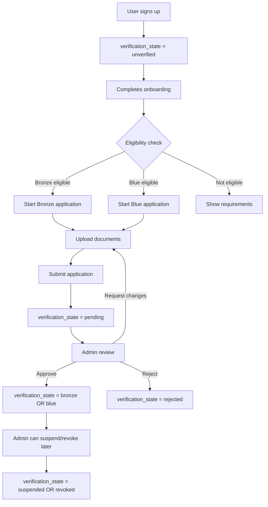

# VERIFICATION

This document records the verification + professional-identity system as actually implemented.

## Architecture overview



## Critical business rule (spec Section 7)

**Payment does NOT equal verification.**

- Pro subscription → grants BRONZE ELIGIBILITY (the right to APPLY for Bronze)
- Premium subscription → grants BLUE ELIGIBILITY (the right to APPLY for Blue)
- The actual badge (`verification_state = bronze` or `blue`) is granted **only** after admin review of the submitted application + documents.

No code path anywhere converts `subscription_tier` into `verification_state`. The Capabilities interface (`src/lib/capabilities/index.ts`) has `eligibleForBronze` / `eligibleForBlue` flags — but these are **eligibility** flags, not auto-grant flags. The flag name explicitly communicates the distinction.

## Verification states (spec Section 14)

| State | Visible publicly? | Meaning |
|---|---|---|
| `unverified` | No (no badge shown) | Default state at signup |
| `pending` | No (no badge shown) | Application submitted, under review |
| `bronze` | Yes — Bronze badge | Bronze application approved |
| `blue` | Yes — Blue badge | Blue application approved |
| `rejected` | No (no badge shown) | Application was rejected; user can re-apply |
| `suspended` | No (badge hidden) | Admin suspended verification independent of account |
| `revoked` | No (badge hidden) | Admin revoked verification entirely |

## Application states

| State | Trigger | Side effect on `verification_state` |
|---|---|---|
| `draft` | User creates draft (for staged document upload) | No change |
| `submitted` | User submits | `unverified` → `pending` |
| `in_review` | Admin clicks "Request changes" | Stays `pending` |
| `approved` | Admin approves | `pending` → `bronze` OR `blue` |
| `rejected` | Admin rejects | `pending` → `rejected` |
| `withdrawn` | User withdraws | `pending` → `unverified` (if currently pending) |
| `expired` | Auto-expiry after 30/60 days | No change (preserves existing state) |

## Eligibility service

`src/lib/verification/eligibility.ts` — the single source of truth for "can this user apply for this tier right now?"

```ts
canApplyForVerification({
  role,
  tier,
  verificationState,
  subscriptionTier,
  emailVerified,
  phoneVerified,
  accountCreatedAt,
  profile,
  roleSpecific,
  existingApplications,
})
```

Returns `EligibilityResult`:

- `canApply: boolean` — true if the user can submit a NEW application now
- `blockingReasons: string[]` — human-readable reasons if `canApply` is false
- `checklist: Array<{ label, description, complete }>` — drives the UI checklist
- `alreadyHasTier: boolean` — user is already at or above the requested tier
- `hasPendingApplication: boolean` — user has a pending application for this tier

### Eligibility checks

1. **Account-level**: account_status must be `active`; verification_state must not be `suspended` or `revoked`
2. **Subscription**: Bronze requires Pro (or Premium); Blue requires Premium
3. **Already has tier**: if `verification_state === bronze` and applying for Bronze, blocked (already has it)
4. **Pending application**: if a `submitted` or `in_review` application for the same tier exists, blocked
5. **Blue requires Bronze first**: applying for Blue when not Bronze-blocked
6. **Profile completeness**: Bronze ≥60%, Blue ≥80%
7. **Email verified**: required for both tiers
8. **Phone verified**: required (when OTP is enabled — currently soft requirement)
9. **Required fields** (role-specific):
   - Agent: `professional_name`, `years_of_experience` (Bronze); `professional_description`, `areas_served` (Blue)
   - Company: `company_name`, `office_address` (Bronze); `company_description` (Blue)
10. **Document requirements**: shown in the checklist but NOT blocking at eligibility time (documents are uploaded during the application flow). The server re-checks document presence at submit time.
11. **Account age**: Blue requires ≥30 days old account

## Requirements configuration

`src/lib/verification/requirements.ts` — configurable per `(role, tier)` pair. Each requirement has:

- `id` — stable identifier for UI
- `label` — human-readable
- `description` — shown in the checklist
- `category` — Profile / Documents / Contact / Account (drives UI grouping)
- `checkType` — how the server verifies (profile_completeness / email_verified / field_present / document_required / document_count / account_age_days / previous_tier)

When requirements need to change, modify this file (single source of truth). Future iterations may persist requirements to the DB for admin-editable rules without code changes.

## Document storage + security

Per spec Sections 11, 12, 13:

- Documents live in the private Supabase Storage bucket `verification-documents`
- Storage path: `{application_id}/{uuid}.{ext}`
- Metadata stored in PostgreSQL (`verification_documents` table)

### Storage policies (migration 0018)

```sql
-- Read: only the applicant (via ownership chain) + admin (via service role)
storage.objects SELECT WHERE bucket_id='verification-documents' AND applicant owns the application

-- Write (INSERT): only the applicant, only while status is 'draft' or 'submitted'
storage.objects INSERT WITH CHECK applicant owns the application

-- Delete: only the applicant
storage.objects DELETE USING applicant owns the application
```

### File validation (server-side)

`src/lib/storage/file-validation.ts`:

1. **Magic-byte MIME sniffing** (read first 16 bytes, match JPEG / PNG / WebP / PDF signatures)
2. **Extension blocklist**: `.exe`, `.bat`, `.cmd`, `.sh`, `.bin`, `.msi`, `.dmg`, `.app`, `.deb`, `.rpm`, `.apk`, `.jar`, `.js`, `.ts`, `.html`, `.svg`, `.zip`, `.rar`, `.7z`, `.tar`, `.gz`
3. **Extension allowlist**: `.jpg`, `.jpeg`, `.png`, `.webp`, `.pdf`
4. **Size limit**: 10 MB per document, 5 MB per avatar
5. **Empty-file rejection**
6. **Client-reported MIME cross-check**: sniffed type wins; mismatches logged

Per spec Section 13: client-provided MIME is NEVER trusted alone.

## User-facing verification flow

1. User visits `/dashboard/verification` — sees current status + eligibility checklist
2. User clicks "Apply for Bronze" (or Blue)
3. Server-side `routeToOnboardingOrDashboard()` + `getOnboardingContext()` verify:
   - User is authenticated
   - User's role matches the route (no cross-role access)
   - User has completed onboarding
   - User is not banned
4. User lands on `/dashboard/verification/apply/[tier]` → `VerificationApplyForm` component
5. Form auto-creates a `draft` application (so documents can be uploaded)
6. User uploads documents (each upload goes through MIME validation)
7. User writes applicant summary
8. User clicks "Submit application"
9. Server action `submitVerificationApplication()` re-checks eligibility + atomic-writes:
   - Insert `verification_applications` row (status=`submitted`)
   - Update `profiles.verification_state` to `pending`
   - Insert `verification_history` row (audit)
   - Insert `audit_logs` row
10. User redirected to `/dashboard/verification?submitted=1`

## Admin review actions (service-layer foundation)

`src/lib/verification/admin-actions.ts` — server actions behind `requireAdmin()` check:

| Action | Effect |
|---|---|
| `approveVerificationApplication({ applicationId, reviewerNotes })` | App status → `approved`; profile.verification_state → `bronze` or `blue`; history + audit + notification written |
| `rejectVerificationApplication({ applicationId, rejectionReason, reviewerNotes })` | App status → `rejected`; profile.verification_state → `rejected` (if was pending); history + audit + notification written |
| `requestVerificationChanges({ applicationId, message })` | App status → `in_review`; reviewer_notes updated; audit logged |
| `revokeVerification({ profileId, reason })` | profile.verification_state → `revoked`; history + audit + notification written |
| `suspendVerification({ profileId, reason })` | profile.verification_state → `suspended`; history + audit + notification written |

All admin actions:
- Use the **service-role** Supabase client (bypasses RLS) — admin actions NEVER happen via client-callable code
- Verify the actor via `requireAdmin()` (checks `admin_users` table OR `ADMIN_EMAILS` env var)
- Write to `audit_logs` for forensic trail
- Write to `verification_history` (append-only) for state transitions
- Send a notification to the applicant via the `notifications` table

The actual admin UI lives in `/admin/verification` (Phase 15) and will call these actions.

## Atomicity

Per spec Section 17: "Use an atomic server-side operation where appropriate. Do not allow a partial approval where the badge changes but the audit/history record fails."

The admin actions update in this order:
1. `verification_applications` row (status + reviewer + timestamps)
2. `profiles` row (verification_state)
3. `verification_history` (append-only audit)
4. `audit_logs` (general-purpose audit)
5. `notifications` (user-facing)

If step 2 succeeds but step 3 fails (best-effort append), the application is approved but the history entry is missing. The code logs loudly so an admin can re-trigger the history entry manually. For the highest-integrity version, this should be wrapped in a Postgres function (added in a future migration if needed).

## Verification history

`verification_history` table — append-only audit trail of every `verification_state` change.

Each row records:
- `profile_id` — whose verification changed
- `previous_state` — what it was before
- `new_state` — what it is now
- `application_id` — which application triggered it (nullable for admin-only actions)
- `actor_id` — admin_users row that made the change (nullable for self-submitted)
- `reason` — free-text reason
- `created_at` — when

RLS: users can READ their own history (for transparency); no user-side UPDATE or DELETE policy. Service role bypasses RLS for admin writes.

## Badge display

`src/components/verification-badge.tsx` — the `VerificationBadge` component.

Props:
- `state: VerificationState`
- `hideWhenNotBadged: boolean` — when true (default), `pending`, `rejected`, `suspended`, `revoked` states render nothing
- `compact: boolean` — render icon-only (used in trust-indicators row)

Visual treatment:
- **Bronze** — copper color (`--color-verification-bronze`), `ShieldCheck` icon
- **Blue** — deep blue color (`--color-verification-blue`), `Check` icon
- Other states — render nothing if `hideWhenNotBadged` is true

## What badges DON'T mean (spec Section 6)

- Blue does NOT mean "better agent"
- Blue does NOT mean "more successful agent"
- Blue does NOT mean "more trustworthy than every Bronze account"
- Blue does NOT mean "guaranteed legitimate transaction"

Blue means: the account has undergone a **higher level of verification under the platform's verification process**.

The distinction is communicated through the badge label ("Bronze Verified" vs "Blue Verified") and the requirement differences (Blue requires Bronze first, account age ≥30 days, additional documents, etc.).

## Future work

- Persist verification requirements to the DB (`verification_requirements` table) for admin-editable rules
- Phone OTP verification (architecture is ready — `phone_verified` column exists; just needs SMS provider credentials)
- Admin verification review UI in `/admin/verification` (Phase 15)
- Verification application expiry cron job (auto-expire drafts after 30/60 days)
- Re-verification flow (when badges expire after a fixed period — future requirement)
